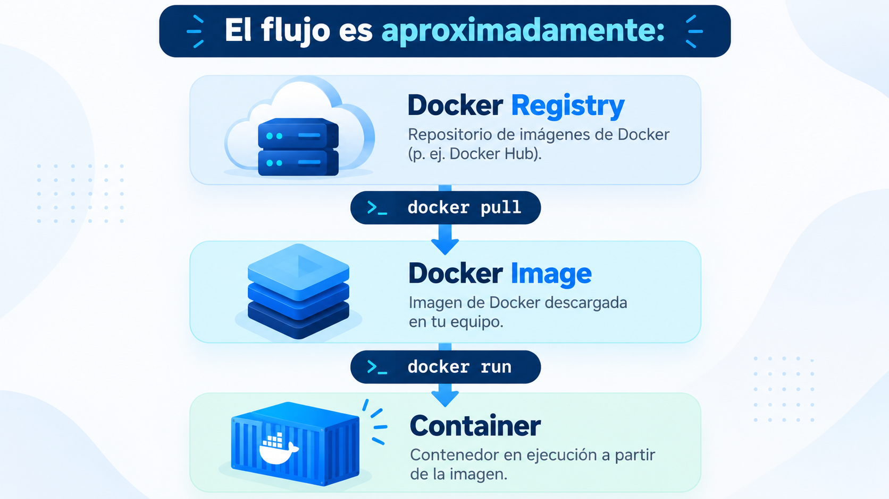

# 🧑🏽‍💻 Clase 47 - Docker Images y Dockerfile

# 1. Docker Images y Dockerfile: Construcción de imágenes propias

Hasta ahora hemos trabajado dos piezas fundamentales de Docker:

- **Persistencia**, mediante volúmenes.
- **Redes**, para permitir la comunicación entre contenedores.

Hasta este momento hemos ejecutado contenedores a partir de imágenes ya existentes. El siguiente paso es comprender **qué es una imagen Docker y cómo construir nuestras propias imágenes**.

# 2. De ejecutar imágenes a construirlas

Hasta ahora hemos utilizado comandos como:

```bash
docker run nginx
```

o:

```bash
docker run postgres:17
```

En estos ejemplos, Docker crea un contenedor a partir de una **imagen existente**.



La pregunta que resolveremos en esta clase es:

> ¿Cómo creamos nuestra propia imagen Docker para ejecutar nuestro propio código?
> 

Para ello utilizaremos un archivo llamado **Dockerfile**.

---

# 3. ¿Qué es una Docker Image?


Por ejemplo, una imagen para una aplicación Python podría contener:


---

# 4. Imagen vs. contenedor


Por ejemplo:


---

# 5. ¿De dónde obtiene Docker las imágenes?


---

# 6. Descargar imágenes: `docker pull`

Podemos descargar una imagen sin crear ningún contenedor mediante:

```bash
docker pull nginx
```

Otro ejemplo:

```bash
docker pull python:3.12-slim
```

Después podemos comprobar las imágenes disponibles localmente.

```bash
docker images
```

También puede utilizarse:

```bash
docker image ls
```

Una salida aproximada sería:

```
REPOSITORY   TAG         IMAGE ID       CREATED       SIZE
python       3.12-slim   abc123...      2 weeks ago   ...
nginx        latest      def456...      3 weeks ago   ...
```

---

# 7. Repositorios y tags

Una referencia habitual a una imagen tiene esta forma:

```
repositorio:tag
```

Por ejemplo:

```
python:3.12-slim
```

Aquí:

```
python     → repositorio
3.12-slim  → tag
```

El **tag** permite identificar una versión o variante concreta de una imagen.

Otros ejemplos:

```
postgres:17
redis:7
python:3.12
python:3.12-slim
```

Si omitimos el tag:

```bash
docker pull nginx
```

Docker utiliza normalmente:

```
nginx:latest
```

## Importante


---

# 8. Inspeccionar una imagen


## Ejemplo: inspeccionar una imagen Docker

El objetivo de este ejemplo es aprender a consultar la configuración interna de una imagen Docker utilizando: `docker image inspect`

### 1. Descargar una imagen

Primero descargamos una imagen concreta de Python:

```
docker pull python:3.12-slim
```

Comprobamos que está disponible localmente:

```
docker images
```

Deberíamos ver algo parecido a:

```
REPOSITORY   TAG         IMAGE ID       CREATED        SIZE
python       3.12-slim   abcdef123456   ...            ...
```

---

### 2. Inspeccionar la imagen

Ejecutamos:

```
docker image inspect python:3.12-slim
```

Docker devolverá una gran cantidad de información en formato JSON. No necesitamos memorizar toda la salida. El objetivo es localizar algunos campos importantes.

---

### 3. Buscar el identificador de la imagen

Dentro de la salida localiza:

```
"Id": "sha256:..."
```

Este valor identifica de forma única la imagen almacenada localmente.

---

### 4. Buscar la arquitectura

Localiza el campo:

```
"Architecture": "amd64"
```

o, dependiendo del equipo:

```
"Architecture": "arm64"
```

Esto nos indica para qué arquitectura fue construida la imagen.

---

### 5. Buscar las variables de entorno

Dentro de:

```
"Config": {
    "Env": [
        ...
    ]
}
```

podemos encontrar variables de entorno definidas en la imagen.

Por ejemplo:

```
PATH=...
LANG=C.UTF-8
PYTHON_VERSION=3.12...
```

---

### 6. Buscar el comando por defecto

Dentro de `Config`, busca:

```
"Cmd": [
    "python3"
]
```

Este campo indica el comando que Docker ejecutará por defecto cuando creemos un contenedor a partir de la imagen. Podemos comprobarlo ejecutando:

```
docker run --rm python:3.12-slim
```

En este caso, Python será el proceso principal del contenedor.

---

### 7. Consultar solo un campo

En lugar de revisar todo el JSON, Docker permite extraer campos concretos. Por ejemplo, para consultar la arquitectura:

```
docker image inspect python:3.12-slim \
  --format '{{.Architecture}}'
```

Resultado posible:

```
amd64
```

Para consultar el sistema operativo:

```
docker image inspect python:3.12-slim \
  --format '{{.Os}}'
```

Resultado:

```
linux
```

Y para consultar el comando por defecto:

```
docker image inspect python:3.12-slim \
  --format '{{json .Config.Cmd}}'
```

Resultado aproximado:

```
["python3"]
```

---

## Ejemplo 2

Inspecciona también la imagen:

```
nginx:latest
```

Primero descárgala:

```
docker pull nginx:latest
```

Después responde a estas preguntas:

1. ¿Qué arquitectura utiliza?
2. ¿Qué sistema operativo utiliza?
3. ¿Qué comando ejecuta por defecto?
4. ¿Tiene variables de entorno configuradas?
5. ¿Cuál es el identificador de la imagen?

Puedes utilizar:

```
docker image inspect nginx:latest
```

o consultar campos concretos mediante `--format`.

---

## Idea clave


---

# 9. Eliminar imágenes

Podemos eliminar una imagen mediante:

```bash
docker image rm nginx
```

También podemos utilizar su identificador:

```bash
docker image rm IMAGE_ID
```

Si existen contenedores que dependen de esa imagen, Docker puede impedir su eliminación hasta que dichos contenedores sean eliminados.

Para revisar el espacio utilizado por Docker:

```bash
docker system df
```

## Ejemplo: eliminar imágenes Docker

---

### 1. Descargar una imagen

Vamos a trabajar con `nginx`:

```bash
docker pull nginx
```

Comprobamos que la imagen está disponible localmente:

```
docker images
```

Deberíamos ver algo similar a:

```
REPOSITORY   TAG       IMAGE ID       CREATED       SIZE
nginx        latest    abc123def456   ...           ...
```

---

### 2. Crear un contenedor a partir de esa imagen

Creamos un contenedor llamado `web-practica`:

```
docker run -d --name web-practica nginx
```

Comprobamos que está ejecutándose:

```
docker ps
```

---

### 3. Intentar eliminar la imagen

Ahora intentamos eliminar la imagen `nginx`:

```
docker image rm nginx
```

Docker debería impedir la eliminación porque existe un contenedor que depende de esa imagen.

### Pregunta


### 4. Detener y eliminar el contenedor

Primero detenemos el contenedor:

```
docker stop web-practica
```

Después lo eliminamos:

```
docker rm web-practica
```

Comprobamos que ya no existe:

```
docker ps -a
```

---

### 5. Eliminar la imagen

Ahora volvemos a intentar:

```
docker image rm nginx
```

Esta vez debería eliminarse correctamente.

Comprobamos el resultado:

```
docker images
```

La imagen `nginx` ya no debería aparecer.

---

## Variante: eliminar por IMAGE ID

Volvemos a descargar la imagen:

```
docker pull nginx
```

Consultamos su identificador:

```
docker images
```

Ejemplo:

```
REPOSITORY   TAG       IMAGE ID
nginx        latest    abc123def456
```

Podemos eliminarla utilizando el identificador:

```
docker image rm abc123def456
```

---

## 6. Revisar el espacio utilizado por Docker

Docker permite consultar cuánto espacio ocupan imágenes, contenedores y otros recursos:

```
docker system df
```

Una salida aproximada podría ser:

```
TYPE            TOTAL     ACTIVE    SIZE
Images          4         2         1.2GB
Containers      3         1         150MB
Local Volumes   2         1         500MB
Build Cache     5         0         320MB
```

---

---

# 10. ¿Qué es un Dockerfile?

Un **Dockerfile** es un archivo de texto que contiene instrucciones para construir una imagen Docker. El nombre habitual es exactamente: `Dockerfile` sin extensión.

Un Dockerfile sencillo podría ser:

```docker
FROM python:3.12-slim

WORKDIR /app

COPY app.py .

CMD ["python", "app.py"]
```

Cada instrucción describe un paso para construir o configurar la imagen.


---

# 11. Primera imagen propia

Vamos a crear una aplicación Python mínima.

Estructura del proyecto:

```
mi-app/
├── Dockerfile
└── app.py
```

Contenido de `app.py`:

```python
print("Hola desde mi primera imagen Docker")
```

Dockerfile:

```docker
FROM python:3.12-slim

WORKDIR /app

COPY app.py .

CMD ["python", "app.py"]
```


Ahora construiremos nuestra imagen.

---

# 12. Construir una imagen: `docker build`

Desde la carpeta que contiene el Dockerfile:

```bash
docker build -t mi-app:1.0 .
```

Analicemos el comando:


Después podemos comprobar que la imagen existe:

```bash
docker images
```

Y ejecutarla:

```bash
docker run --rm mi-app:1.0
```

Resultado esperado:

```
Hola desde mi primera imagen Docker
```

---

# 13. El contexto de construcción

Cuando ejecutamos:

```bash
docker build -t mi-app:1.0 .
```

el último argumento indica el **build context**. El contexto contiene los archivos que Docker puede utilizar durante la construcción.

Por ejemplo:

```
mi-app/
├── Dockerfile
├── app.py
├── requirements.txt
└── data/
```

Si ejecutamos el build desde `mi-app/` con:

```bash
docker build -t mi-app:1.0 .
```

Docker podrá utilizar los archivos incluidos en ese contexto mediante instrucciones como `COPY`. Por eso debemos evitar incluir archivos innecesarios o muy pesados en el contexto.

---

# 14. Instrucción `FROM`

La mayoría de Dockerfiles comienzan con `FROM`.

Ejemplo:

```docker
FROM python:3.12-slim
```

`FROM` define la **imagen base** sobre la que construiremos nuestra imagen.


En Ingeniería de Datos podríamos utilizar imágenes base como:

```docker
FROM python:3.12-slim
```

mientras que para una base de datos normalmente utilizaríamos directamente una imagen mantenida para ese software, como:

```
postgres:17
```

---

# 15. Instrucción `WORKDIR`

`WORKDIR` establece el directorio de trabajo dentro de la imagen.

```docker
WORKDIR /app
```

A partir de ese momento, instrucciones posteriores pueden trabajar relativamente a `/app`.

Por ejemplo:

```docker
WORKDIR /app
COPY app.py .
```

significa que `app.py` terminará en:

```
/app/app.py
```

Además, cuando el contenedor arranque, ese directorio será el directorio de trabajo por defecto.

---

# 16. Instrucción `COPY`

`COPY` copia archivos desde el contexto de construcción hacia la imagen.

Ejemplo:

```docker
COPY app.py .
```

Con:

```docker
WORKDIR /app
```

el resultado será:

```
/app/app.py
```

También podemos copiar varios archivos:

```docker
COPY requirements.txt .
```

O un directorio:

```docker
COPY src/ ./src/
```

Debemos ser conscientes de qué archivos estamos incorporando a la imagen.

---

# 17. Instrucción `RUN`

`RUN` ejecuta un comando **durante la construcción de la imagen**.

Por ejemplo:

```docker
RUN pip install pandas
```

Esto instala `pandas` mientras Docker construye la imagen. Un ejemplo más habitual es utilizar un archivo de dependencias:

```docker
COPY requirements.txt .
RUN pip install --no-cache-dir -r requirements.txt
```

Contenido de `requirements.txt`:

```
pandas==2.2.3
```

La idea fundamental es:

```
RUN → se ejecuta durante docker build
```

No cada vez que iniciamos un contenedor.

---

# 18. Instrucción `CMD`

`CMD` define el comando por defecto que se ejecutará cuando se cree un contenedor a partir de la imagen.

Ejemplo:

```docker
CMD ["python", "app.py"]
```

Por tanto:

```bash
docker run mi-app:1.0
```

terminará ejecutando:

```
python app.py
```

## Diferencia fundamental

```
RUN → construcción de la imagen
CMD → ejecución del contenedor
```

Esta diferencia suele causar confusión al principio.

---

# 19. Forma exec de `CMD`

Es habitual escribir `CMD` como:

```docker
CMD ["python", "app.py"]
```

Cada elemento es un argumento separado.

Otro ejemplo:

```docker
CMD ["python", "etl.py", "--mode", "daily"]
```

Para esta clase utilizaremos preferentemente esta forma.

---

# 20. Instrucción `ENV`

Podemos definir variables de entorno dentro de una imagen.

```docker
ENV APP_ENV=production
```

Una aplicación Python podría leerla:

```python
import os

print(os.getenv("APP_ENV"))
```

Al ejecutar el contenedor:

```bash
docker run mi-app:1.0
```

el valor por defecto será:

```
production
```

Podemos sobrescribirlo al ejecutar:

```bash
docker run -e APP_ENV=development mi-app:1.0
```

## Importante

No debemos incorporar contraseñas, tokens o secretos directamente en el Dockerfile mediante `ENV`. Una imagen puede distribuirse o almacenarse en un registry, por lo que los secretos requieren una gestión separada.

---

# 21. Instrucción `EXPOSE`

Podemos documentar el puerto que utiliza una aplicación mediante:

```docker
EXPOSE 8000
```

Por ejemplo:

```docker
FROM python:3.12-slim
WORKDIR /app
COPY . .
EXPOSE 8000
CMD ["python", "app.py"]
```

Es importante entender que:

```docker
EXPOSE 8000
```

**no publica automáticamente el puerto en nuestra máquina**.

Para publicar un puerto al ejecutar el contenedor seguimos utilizando:

```bash
docker run -p 8000:8000 mi-api:1.0
```

Esto conecta con lo visto en la clase de **redes**.

---

# 22. Dockerfile con dependencias Python

Vamos a construir una imagen más realista.

Estructura:

```
etl-project/
├── Dockerfile
├── requirements.txt
└── etl.py
```

`requirements.txt`:

```
pandas==2.2.3
```

`etl.py`:

```python
import pandas as pd

records = [
    {"product": "A", "amount": 100},
    {"product": "B", "amount": 150},
    {"product": "A", "amount": 200},
]

df = pd.DataFrame(records)

result = df.groupby("product", as_index=False)["amount"].sum()

print(result)
```

Dockerfile:

```docker
FROM python:3.12-slim

WORKDIR /app

COPY requirements.txt .

RUN pip install --no-cache-dir -r requirements.txt

COPY etl.py .

CMD ["python", "etl.py"]
```

Construimos la imagen:

```bash
docker build -t etl-pandas:1.0 .
```

La ejecutamos:

```bash
docker run --rm etl-pandas:1.0
```

Hemos empaquetado:

```
Python
+
pandas
+
nuestro ETL
+
comando de ejecución
```

como una única imagen reproducible.

---

# 23. ¿Qué ocurre durante `docker build`?

Cuando ejecutamos:

```bash
docker build -t etl-pandas:1.0 .
```

Docker procesa las instrucciones del Dockerfile.

Conceptualmente:


El resultado final es una nueva imagen disponible localmente.

---

# 24. Imágenes y capas


Las imágenes Docker se construyen mediante un sistema de **capas**.

De forma simplificada:

```
┌──────────────────────────────┐
│ COPY etl.py .                │
├──────────────────────────────┤
│ RUN pip install ...          │
├──────────────────────────────┤
│ COPY requirements.txt .      │
├──────────────────────────────┤
│ python:3.12-slim             │
└──────────────────────────────┘
```

<aside>
💡

No necesitamos conocer todavía los detalles internos de almacenamiento, pero sí comprender que **el orden del Dockerfile importa**.

</aside>

---

# 25. Caché de construcción

Docker puede reutilizar resultados de pasos anteriores cuando nada relevante ha cambiado.

Consideremos:

```docker
COPY requirements.txt .
RUN pip install --no-cache-dir -r requirements.txt
COPY . .
```

Si modificamos únicamente nuestro código pero no `requirements.txt`, Docker puede evitar repetir innecesariamente la instalación de todas las dependencias.

Por eso este orden suele ser preferible a:

```docker
COPY . .
RUN pip install --no-cache-dir -r requirements.txt
```

porque cualquier cambio en cualquier archivo copiado puede invalidar antes el trabajo reutilizable.

## Idea clave

Colocamos primero las instrucciones que cambian con menor frecuencia y dejamos el código que cambia habitualmente para pasos posteriores cuando sea posible.

---

# 26. `.dockerignore`


## Importante

`.dockerignore` ayuda a excluir archivos, pero no sustituye una estrategia adecuada de gestión de secretos.

---

# 27. Etiquetar una imagen

Podemos crear otro tag para una imagen existente:

```bash
docker tag etl-pandas:1.0 etl-pandas:latest
```

Ahora:

```bash
docker images
```

podría mostrar:

```
REPOSITORY   TAG      IMAGE ID
etl-pandas   1.0      abc123
etl-pandas   latest   abc123
```

Los dos nombres pueden apuntar inicialmente a la misma imagen. Los tags resultan especialmente importantes al publicar imágenes en registries.


---

# 28. Imágenes en un registry


En esta clase nos centraremos principalmente en **construir y utilizar imágenes localmente**.

---

# 29. Buenas prácticas básicas

Al crear nuestras primeras imágenes conviene seguir unas reglas sencillas.

## 29.1 Utilizar una imagen base adecuada

Por ejemplo:

```docker
FROM python:3.12-slim
```

Una imagen más pequeña puede reducir el tamaño final y el tiempo de descarga.

## 29.2 Utilizar versiones explícitas

Preferible:

```docker
FROM python:3.12-slim
```

frente a depender siempre de:

```docker
FROM python:latest
```

## 29.3 No incluir archivos innecesarios

Utilizar `.dockerignore`.

## 29.4 Aprovechar la caché

Copiar e instalar dependencias antes de copiar código que cambia frecuentemente.

## 29.5 No almacenar secretos en la imagen

Evitar:

```docker
ENV DB_PASSWORD=supersecret
```

Las credenciales deben suministrarse mediante mecanismos externos adecuados.

## 29.6 Mantener una responsabilidad clara

En general, una imagen debe representar un componente o servicio concreto de nuestra arquitectura.

---

# 30. Ejercicio 1

Nuestro objetivo será construir una imagen que lea un CSV, realice una transformación y escriba el resultado.

Estructura:

```
etl-csv/
├── Dockerfile
├── requirements.txt
└── etl.py
```

`requirements.txt`:

```
pandas==2.2.3
```

`etl.py`:

```python
import pandas as pd

input_path = "/data/input.csv"
output_path = "/data/output.csv"

df = pd.read_csv(input_path)

result = (
    df.groupby("category", as_index=False)["amount"]
      .sum()
)

result.to_csv(output_path, index=False)

print(f"Resultado generado en{output_path}")
```

Dockerfile:

```docker
FROM python:3.12-slim

WORKDIR /app

COPY requirements.txt .
RUN pip install --no-cache-dir -r requirements.txt

COPY etl.py .

CMD ["python", "etl.py"]
```

Construcción:

```bash
docker build -t etl-csv:1.0 .
```

Creamos una carpeta `data` en nuestra máquina con:

```
data/input.csv
```

Ejemplo:

```
category,amount
A,100
B,200
A,50
B,25
```

Ejecutamos:

```bash
docker run --rm \
  -v "$(pwd)/data:/data" \
  etl-csv:1.0
```

El proceso que ocurre es:


Aquí combinamos:

```
Docker Image
+
Dockerfile
+
Contenedor
+
Persistencia
```

---

# 31. Modificar el código implica reconstruir la imagen

Supongamos que cambiamos `etl.py`.

La imagen existente:

```
etl-csv:1.0
```

**no cambia automáticamente**.

Debemos construir una nueva imagen:

```bash
docker build -t etl-csv:1.1 .
```

Ahora tenemos dos versiones:

```
etl-csv:1.0
etl-csv:1.1
```

Esto ilustra una de las ventajas importantes de las imágenes:

> Podemos versionar y distribuir distintas versiones de una aplicación de forma controlada.
> 

---

---

# 34. Ejercicio 2

## Objetivo

Construir y ejecutar una imagen Docker propia para un pequeño proceso de Ingeniería de Datos.

## Paso 1. Crear el proyecto

```
student-etl/
├── Dockerfile
├── .dockerignore
├── requirements.txt
└── main.py
```

## Paso 2. Crear `main.py`

```python
import pandas as pd

sales = pd.DataFrame(
    {
        "country": ["ES", "ES", "FR", "FR"],
        "sales": [100, 250, 125, 300],
    }
)

summary = sales.groupby("country", as_index=False)["sales"].sum()

print(summary)
```

## Paso 3. Crear `requirements.txt`

```
pandas==2.2.3
```

## Paso 4. Crear `.dockerignore`

```
__pycache__/
*.pyc
.venv/
.git/
.env
```

## Paso 5. Crear el Dockerfile

```docker
FROM python:3.12-slim

WORKDIR /app

COPY requirements.txt .
RUN pip install --no-cache-dir -r requirements.txt

COPY main.py .

CMD ["python", "main.py"]
```

## Paso 6. Construir

```bash
docker build -t student-etl:1.0 .
```

## Paso 7. Comprobar la imagen

```bash
docker image ls
```

## Paso 8. Ejecutar

```bash
docker run --rm student-etl:1.0
```

## Paso 9. Modificar el código

Añadir una nueva columna al resultado:

```python
summary["currency"] = "EUR"
```

## Paso 10. Crear una nueva versión

```bash
docker build -t student-etl:1.1 .
```

## Paso 11. Comparar versiones

```bash
docker image ls student-etl
```

Ejecutar ambas:

```bash
docker run --rm student-etl:1.0
```

```bash
docker run --rm student-etl:1.1
```

---

# 35. Ejercicio 3 : interpretar un Dockerfile

Dado:

```docker
FROM python:3.12-slim

WORKDIR /pipeline

COPY requirements.txt .
RUN pip install --no-cache-dir -r requirements.txt

COPY src/ ./src/

ENV MODE=batch

CMD ["python", "src/pipeline.py"]
```

Responder:

1. ¿Cuál es la imagen base?
2. ¿Cuál es el directorio de trabajo?
3. ¿Qué instrucción instala dependencias?
4. ¿Cuándo se ejecuta el `RUN`?
5. ¿Cuándo se ejecuta el `CMD`?
6. ¿Qué valor tendrá `MODE` por defecto?
7. ¿Dónde quedará copiado el directorio `src`?
8. ¿Qué comando utilizarías para construir `pipeline:1.0`?
9. ¿Qué comando utilizarías para ejecutar la imagen?

---

---

# 37. Ejercicio 4

Crear una imagen llamada:

```
sales-etl:1.0
```

que cumpla los siguientes requisitos:

- Utilice Python 3.12 como base.
- Trabaje dentro de `/app`.
- Instale `pandas` desde `requirements.txt`.
- Copie un programa `sales_etl.py`.
- Lea `/data/sales.csv`.
- Agrupe las ventas por producto.
- Genere `/data/summary.csv`.
- Se ejecute automáticamente al iniciar el contenedor.
- Utilice un `.dockerignore` apropiado.
- No incorpore los datos CSV dentro de la propia imagen.

La ejecución debería ser similar a:

```bash
docker run --rm \
  -v "$(pwd)/data:/data" \
  sales-etl:1.0
```