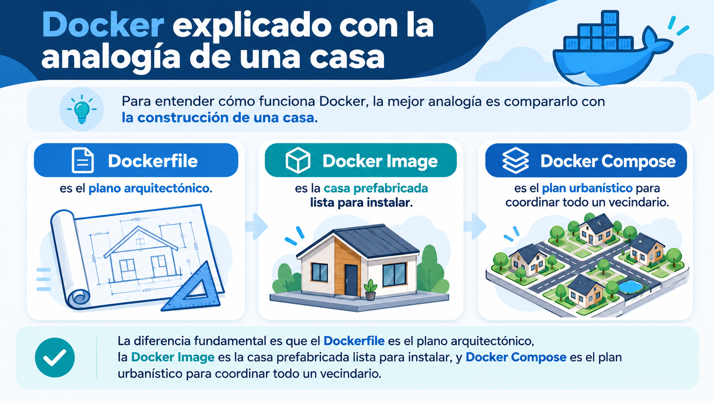
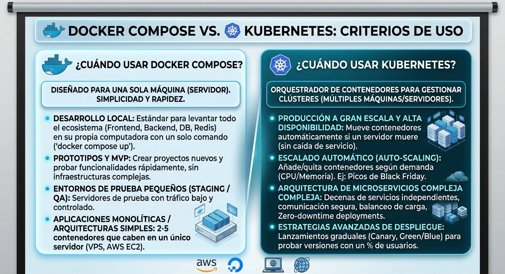
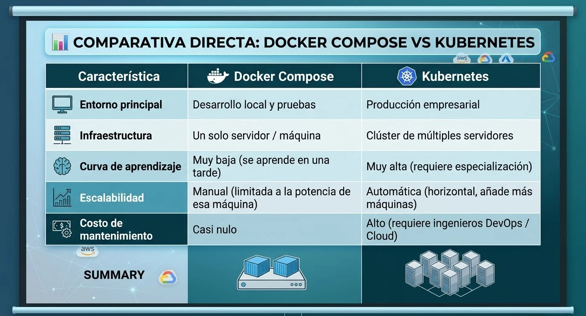
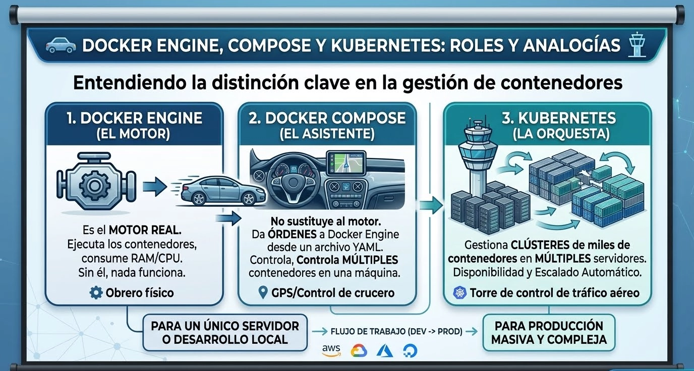

# 🧑🏽‍💻 Clase 48 - Docker Compose. Aplicaciones multicontenedor

# Intorducción: Diferencia entre Dockerfile, Docker Image y Docker Compose



---

# Docker Compose vs Kubernetes


---

# Criterios de uso



---

# Comparativa



---

# ¿ Se pueden usar juntos Docker compose y Kubernetes?


---

# 1. ¿Qué problema resuelve Docker Compose?

<aside>
💡

En las clases anteriores ejecutamos contenedores por separado. Por ejemplo, para poner en marcha una aplicación con PostgreSQL, una red y un volumen, podríamos necesitar:

</aside>

```bash
docker network create datos-net
docker volume create postgres-datos

docker run -d \
  --name postgres-manual \
  --network datos-net \
  -e POSTGRES_PASSWORD=curso123 \
  -e POSTGRES_DB=empresa \
  -v postgres-datos:/var/lib/postgresql/data \
  postgres:16
```

---

**¿Qué inconvenientes tiene esta forma de trabajar?**

- Es necesario recordar varios comandos largos.
- Hay que crear manualmente algunos recursos.
- Si tenemos varios servicios, mantener todos los comandos se complica.
- Es más difícil reproducir exactamente la aplicación en otro equipo.

---

**Con Docker Compose** escribimos la configuración en un archivo `compose.yaml` y arrancamos los servicios con:

```bash
docker compose up -d
```

Docker Compose interpreta el archivo, crea los recursos necesarios y arranca los contenedores.

> **Distinción clave:** Docker Compose **no sustituye a Docker Engine**. Utiliza Docker Engine para crear y administrar contenedores. Tampoco es Kubernetes: en esta clase gestionamos una aplicación Docker, normalmente en un único servidor.
> 

---

# Docker Engine, Compose y Kubernetes



---

# 2. Conceptos esenciales


---

# 2.1. Cómo funciona un proyecto Compose


---

# Laboratorio 1 — Primer Docker Compose: un único Nginx

## 3. Crear nuestro primer proyecto

> **Objetivo:** ejecutar exactamente el mismo servidor web Nginx que ya conocemos de la clase 44, pero ahora desde un archivo Compose.
> 

### Paso 1. Crear una carpeta independiente

En Ubuntu Server:

```bash
mkdir -p ~/proyectos/clase48/01-nginx
cd ~/proyectos/clase48/01-nginx
```

Cada laboratorio tendrá su propia carpeta. Esto evita mezclar configuraciones y recursos de distintos ejercicios.

---

### Paso 2. Crear `compose.yaml`

Desde el explorador de VS Code, crea el archivo `compose.yaml` con este contenido:

```yaml
services:
web:
image: nginx:alpine
ports:
-"8080:80"
```

---

### Paso 3. Entender cada línea

```yaml
services:                # Sección con los servicios de la aplicación
web:                   # Nombre que damos a este servicio
image: nginx:alpine  # Imagen que ejecutaremos
ports:               # Puertos publicados
-"8080:80"        # Puerto Ubuntu : puerto contenedor
```

**Interpretación de `"8080:80"`:**

```
Navegador → IP_DE_UBUNTU:8080 → Ubuntu Server:8080 → Nginx:80
```

El puerto `8080` pertenece al **host Ubuntu**, y `80` es el puerto del **contenedor Nginx**. Usamos `8080` para evitar conflictos con servicios que ya puedan ocupar el puerto 80.

> **YAML:** los espacios de indentación importan. Utiliza **espacios**, no tabulaciones. Las comillas en `"8080:80"` son recomendables. No hace falta añadir una clave `version:` al principio del archivo.
> 

---

### Paso 4. Validar la configuración

```bash
docker compose config
```

**¿Qué hace?** Comprueba e interpreta la configuración y muestra su representación normalizada. Es una buena forma de detectar errores de YAML antes de ejecutar contenedores.

---

### Paso 5. Arrancar Nginx

```bash
docker compose up -d
```

- `up`: crea e inicia los servicios definidos en el archivo.
- `d`: los deja ejecutándose en segundo plano (**detached**).

Consulta su estado:

```bash
docker compose ps
```

**Resultado esperado:** un servicio `web` en ejecución con el puerto `8080` publicado hacia el `80` del contenedor.

---

### Paso 6. Probar la página

Desde Ubuntu Server:

```bash
curl http://localhost:8080
```

Debería devolverse el HTML de la página de bienvenida de Nginx.

Desde el navegador de **Windows** puedes abrir:

```
http://IP_DE_UBUNTU:8080
```

Sustituye `IP_DE_UBUNTU` por la IP real de tu máquina virtual, obtenida mediante `hostname -I`. También puedes utilizar el panel **PORTS** de VS Code para reenviar el puerto `8080`.

> **Atención:** si Docker se ejecuta en Ubuntu Server, `localhost` en Windows **no** se refiere a Ubuntu, salvo que hayas configurado un túnel o reenvío de puertos.
> 

---

### Paso 7. Ver registros y detener

```bash
docker compose logs web
docker compose logs -f web
```

La segunda orden sigue los logs en tiempo real; pulsa `Ctrl + C` para dejar de verlos. El servicio continúa en ejecución.

Para detenerlo:

```bash
docker compose stop
```

Para volver a arrancarlo:

```bash
docker compose start
```

---

Para terminar el ejercicio y eliminar los contenedores y la red creada por Compose:

```bash
docker compose down
```

**Idea clave:** `stop` detiene sin eliminar contenedores; `down` elimina los contenedores y redes del proyecto. Las imágenes descargadas no se eliminan normalmente al usar `down`.

### Ejercicio 1

Modifica el archivo para acceder a Nginx por el **puerto 8081** del servidor Ubuntu. Comprueba que funciona y explica por qué el puerto del contenedor sigue siendo el `80`.

---

# Laboratorio 2 — Una aplicación web personalizada

## 4. Utilizar un Bind Mount con Compose

**Objetivo:** servir nuestro propio archivo HTML sin crear todavía un Dockerfile.

---

### Paso 1. Crear el proyecto

```bash
mkdir -p ~/proyectos/clase48/02-web-personalizada/html
cd ~/proyectos/clase48/02-web-personalizada
```

Crea `html/index.html`:

```html
<!DOCTYPE html>
<html lang="es">
<head>
  <meta charset="UTF-8">
  <title>Mi primera web con Compose</title>
</head>
<body>
  <h1>¡Hola desde Docker Compose!</h1>
  <p>Esta página se almacena en Ubuntu Server.</p>
</body>
</html>
```

---

### Paso 2. Crear `compose.yaml`

```yaml
services:
web:
image: nginx:alpine
ports:
-"8081:80"
volumes:
- ./html:/usr/share/nginx/html:ro
```

**Novedad:**

```yaml
volumes:
- ./html:/usr/share/nginx/html:ro
```

- `./html`: carpeta del proyecto en Ubuntu Server.
- `/usr/share/nginx/html`: directorio donde Nginx sirve archivos dentro del contenedor.
- `ro`: *read-only*, Nginx solo puede leer los archivos de ese montaje.

Este montaje es un **Bind Mount**, como vimos en la clase 45.

---

### Paso 3. Ejecutar y verificar

```bash
docker compose config
docker compose up -d
docker compose ps
curl http://localhost:8081
```

**Resultado esperado:** aparece el HTML que acabamos de crear.

Edita `html/index.html`, guarda el archivo y recarga la página. **Verás el cambio sin reconstruir una imagen**, porque Nginx lee el archivo del Bind Mount.

---

### Paso 4. Limpiar

```bash
docker compose down
```

### Ejercicio 2

Añade un segundo párrafo al HTML, vuelve a abrir la página y responde: **¿por qué no hemos necesitado ejecutar `docker build`?**

---

# Laboratorio 3 — Construir nuestra propia imagen con Compose

## 5. Usar `build` y un Dockerfile

Ya hemos utilizado una imagen existente (`nginx:alpine`). Ahora recordamos la **clase 47** y construimos nuestra imagen Python.

---

### Paso 1. Preparar el proyecto

```bash
mkdir -p ~/proyectos/clase48/03-python
cd ~/proyectos/clase48/03-python
```

Estructura:

```
03-python/
├── app.py
├── Dockerfile
└── compose.yaml
```

Archivo `app.py`:

```python
print("Hola desde Python ejecutado con Docker Compose")
```

---

Archivo `Dockerfile`:

```docker
FROM python:3.12-slim
WORKDIR /app
COPY app.py .
CMD ["python", "app.py"]
```

Archivo `compose.yaml`:

```yaml
services:
programa:
build: .
image: clase48-python:1.0
```

---

### Paso 2. Comprender las novedades

- `build: .` indica que el **contexto de construcción** es la carpeta actual, donde se encuentra el Dockerfile.
- `image: clase48-python:1.0` da un nombre y una etiqueta a la imagen construida.
- No necesitamos publicar puertos: este programa imprime un mensaje y termina.

---

### Paso 3. Construir y ejecutar

```bash
docker compose build
docker compose up
```

**Resultado esperado:**

```
Hola desde Python ejecutado con Docker Compose
```

---

El programa finaliza y, por tanto, el contenedor también. **No es un error**: no todas las aplicaciones deben ejecutarse de forma permanente. Las tareas ETL y otros trabajos por lotes también suelen finalizar.

Comprueba lo ocurrido:

```bash
docker compose ps -a
```

---

### Paso 4. Modificar el programa

Cambia `app.py` por:

```python
print("Segunda versión del programa Python")
```

Reconstruye y ejecuta:

```bash
docker compose up --build
```

**Importante:** a diferencia del laboratorio 2, aquí el archivo `app.py` queda **copiado dentro de la imagen**. Cuando lo modificamos, debemos reconstruir la imagen para incorporar el cambio.

---

### Paso 5. Limpiar

```bash
docker compose down
```

### Ejercicio 3

Explica cuándo usarías un **Bind Mount** y cuándo preferirías copiar el código dentro de una **imagen** mediante `Dockerfile`.

---

# Laboratorio 4 — Dos servicios: una base de datos y una aplicación Python

## 6. Primer ejemplo multicontenedor

<aside>
💡

En este laboratorio uniremos dos tecnologías que ya hemos utilizado:

- **PostgreSQL** para almacenar datos.
- **Python** para conectarse a PostgreSQL y realizar una consulta.

La diferencia respecto a la clase 46 es que **no crearemos la red ni los contenedores manualmente**: Compose los gestionará.

</aside>

---

### 6.1. Arquitectura


**Punto fundamental:** Python utilizará `db` como nombre del servidor PostgreSQL, **no** `localhost` ni una IP interna fija.

---


---

### 6.2. Crear carpetas y archivos

```bash
mkdir -p ~/proyectos/clase48/04-python-postgres
cd ~/proyectos/clase48/04-python-postgres
```

Estructura:

```
04-python-postgres/
├── app.py
├── requirements.txt
├── Dockerfile
└── compose.yaml
```

---

Archivo `requirements.txt`:

```
psycopg[binary]>=3.2,<4
```

El paquete `psycopg` permite conectar Python con PostgreSQL. En este laboratorio usaremos la versión 3 de la librería.

---

Archivo `app.py`:

```python
import os
import psycopg

conexion = psycopg.connect(
    host=os.environ["DB_HOST"],
    port=5432,
    dbname=os.environ["POSTGRES_DB"],
    user=os.environ["POSTGRES_USER"],
    password=os.environ["POSTGRES_PASSWORD"],
)

with conexion:
    with conexion.cursor() as cursor:
        cursor.execute("SELECT version();")
        version = cursor.fetchone()[0]
        print("Conexión correcta con PostgreSQL")
        print("Versión del servidor:", version)
```

---

Archivo `Dockerfile`:

```docker
FROM python:3.12-slim
WORKDIR /app
COPY requirements.txt .
RUN pip install --no-cache-dir -r requirements.txt
COPY app.py .
CMD ["python", "app.py"]
```

---

### 6.3. Crear nuestro primer Compose con dos servicios

Archivo `compose.yaml`:

```yaml
services:
db:
image: postgres:16
environment:
POSTGRES_USER: curso
POSTGRES_PASSWORD: curso123
POSTGRES_DB: empresa
healthcheck:
test:["CMD-SHELL","pg_isready -U curso -d empresa"]
interval: 5s
timeout: 3s
retries:10

app:
build: .
environment:
DB_HOST: db
POSTGRES_USER: curso
POSTGRES_PASSWORD: curso123
POSTGRES_DB: empresa
depends_on:
db:
condition: service_healthy
```

> **Contraseña de laboratorio:** `curso123` es **exclusivamente didáctica**. No la reutilices en sistemas reales ni la incorpores a un repositorio público como secreto de producción.
> 

---

### 6.4. ¿Qué significa cada parte?

| Configuración | Explicación |
| --- | --- |
| `db` | Nombre del servicio PostgreSQL. |
| `image: postgres:16` | Usa la imagen PostgreSQL 16. |
| `environment` | Pasa variables de entorno a un contenedor. |
| `app` | Nombre del servicio Python. |
| `build: .` | Construye la imagen de Python desde el Dockerfile. |
| `DB_HOST: db` | Python se conecta al nombre del servicio `db`. |
| `depends_on` | Establece una dependencia de arranque de `app` respecto a `db`. |
| `healthcheck` | Comprueba si PostgreSQL está listo para aceptar conexiones. |
| `condition: service_healthy` | Espera a que el servicio `db` esté saludable antes de iniciar `app`. |

> **Importante:** `depends_on` sin comprobación de salud solo organiza el orden de arranque; **no garantiza** que PostgreSQL esté preparado para recibir conexiones. Por eso añadimos `healthcheck`. En aplicaciones reales también es buena práctica gestionar reintentos de conexión.
> 

---

### 6.5. Iniciar la aplicación

```bash
docker compose config
docker compose up --build
```

**Qué debería ocurrir:**

1. Se obtiene la imagen de PostgreSQL si no existe.
2. Se construye nuestra imagen Python.
3. Docker Compose crea una red propia del proyecto.
4. Arranca PostgreSQL.
5. Espera a que el `healthcheck` sea satisfactorio.
6. Arranca Python, que consulta PostgreSQL y finaliza.

---

Busca entre los logs las líneas:

```
Conexión correcta con PostgreSQL
Versión del servidor: PostgreSQL ...
```

Para comprobarlo con mayor claridad, desde otra terminal remota:

```bash
docker compose ps -a
docker compose logs app
docker compose logs db
```

**Esperado:** `db` permanece activo y saludable; `app` termina correctamente tras ejecutar la consulta.

---

### 6.6. Inspeccionar la red

```bash
docker network ls
```

Compose habrá creado una red cuyo nombre se parece a `04-python-postgres_default` (el prefijo real depende del nombre del proyecto). **No fue necesario ejecutar `docker network create`.**

> No hemos publicado el puerto `5432` en Ubuntu. Python puede conectarse a PostgreSQL porque ambos servicios comparten la red de Compose. Publicar un puerto no es necesario para la comunicación interna entre contenedores.
> 

---

### 6.7. Limpiar antes del siguiente laboratorio

```bash
docker compose down
```

### Ejercicio 4

Contesta:

1. ¿Por qué `DB_HOST` tiene el valor `db`?
2. ¿Podríamos utilizar `localhost` en Python para conectarnos al otro contenedor?
3. ¿Por qué no aparece `ports: - "5432:5432"` en el servicio `db`?
4. ¿Qué aporta el `healthcheck`?

---

# Laboratorio 5 — PostgreSQL persistente + Python + Docker Compose

## 7. Añadir persistencia a la aplicación

<aside>
💡

Ahora mejoraremos el laboratorio anterior con un **volumen Docker** que conservará los datos de PostgreSQL cuando eliminemos los contenedores.

</aside>

> **Nuevo objetivo:** crear una tabla, guardar registros, eliminar los contenedores, volver a iniciarlos y comprobar que los registros siguen existiendo.
> 

---

### 7.1. Crear un proyecto nuevo

```bash
mkdir -p ~/proyectos/clase48/05-persistencia
cd ~/proyectos/clase48/05-persistencia
```

En este laboratorio solo necesitaremos `compose.yaml`, porque utilizaremos el cliente `psql` que ya contiene la imagen oficial de PostgreSQL.

---

### 7.2. Crear `compose.yaml`

```yaml
services:
db:
image: postgres:16
environment:
POSTGRES_USER: curso
POSTGRES_PASSWORD: curso123
POSTGRES_DB: empresa
volumes:
- datos-postgres:/var/lib/postgresql/data
healthcheck:
test:["CMD-SHELL","pg_isready -U curso -d empresa"]
interval: 5s
timeout: 3s
retries:10

volumes:
datos-postgres:
```

---

**Novedad:** existen dos apariciones de `volumes` con funciones diferentes.

```yaml
services:
db:
volumes:
- datos-postgres:/var/lib/postgresql/data  # Monta el volumen en db

volumes:
datos-postgres:                               # Declara el volumen
```

Docker Compose crea y administra el volumen. Su nombre real normalmente incluirá el **nombre del proyecto** como prefijo, de modo que varios proyectos pueden tener volúmenes llamados `datos-postgres` sin colisionar.

---

### 7.3. Arrancar PostgreSQL

```bash
docker compose up -d
docker compose ps
docker volume ls
```

**Resultado esperado:** servicio `db` ejecutándose y un volumen nuevo relacionado con el proyecto.

---

### 7.4. Crear una tabla e insertar datos

Entramos a PostgreSQL desde Ubuntu Server:

```bash
docker compose exec db psql -U curso -d empresa
```

---

En la consola de PostgreSQL (`psql`) ejecuta:

```sql
CREATE TABLE ventas (
    id INTEGER PRIMARY KEY,
    producto VARCHAR(100),
    importe NUMERIC(10,2)
);

INSERT INTO ventas VALUES
(1, 'Teclado', 50.00),
(2, 'Monitor', 200.00),
(3, 'Ratón', 25.00);

SELECT * FROM ventas;
```

Salida esperada (el formato puede variar):

```
 id | producto | importe
----+----------+---------
  1 | Teclado  |   50.00
  2 | Monitor  |  200.00
  3 | Ratón    |   25.00
```

---

Sal de `psql` con:

```
\q
```

---

### 7.5. Eliminar los contenedores

```bash
docker compose down
```

Ahora consulta:

```bash
docker volume ls
```

**Resultado esperado:** el volumen del proyecto sigue existiendo.

---

### 7.6. Recrear los contenedores

```bash
docker compose up -d
```

Vuelve a entrar a PostgreSQL:

```bash
docker compose exec db psql -U curso -d empresa
```

Consulta:

```sql
SELECT * FROM ventas;
```

**Resultado esperado:** siguen apareciendo los tres registros.

**Conclusión:** el contenedor PostgreSQL puede eliminarse y recrearse sin perder los datos almacenados en su volumen.

---

### 7.7. Diferencia entre `down` y `down -v`

| Comando | Contenedores y red del proyecto | Volúmenes declarados (no externos) |
| --- | --- | --- |
| `docker compose stop` | Los detiene; no elimina | Se conservan |
| `docker compose down` | Los elimina | Se conservan |
| `docker compose down -v` | Los elimina | **Se eliminan** |

> ⚠️ **Precaución:** `docker compose down -v` puede borrar **definitivamente los datos** de los volúmenes del proyecto. **No lo ejecutes** antes de comprobar la persistencia. Los volúmenes externos no se eliminan con esta opción.
> 

---

### Ejercicio 5

Inserta dos ventas adicionales. Ejecuta `docker compose down`, vuelve a levantar el proyecto y demuestra mediante `SELECT * FROM ventas;` que ahora hay cinco registros.

---

# 8. Variables de entorno y archivo `.env`

En los ejemplos anteriores repetimos las mismas credenciales en el YAML. Compose admite **sustitución de variables** desde un archivo `.env` situado junto al `compose.yaml`.

---

Partimos del laboratorio 5. Crea un archivo `.env`:

```
DB_USER=curso
DB_PASSWORD=curso123
DB_NAME=empresa
```

Modifica `compose.yaml`:

```yaml
services:
db:
image: postgres:16
environment:
POSTGRES_USER: ${DB_USER}
POSTGRES_PASSWORD: ${DB_PASSWORD}
POSTGRES_DB: ${DB_NAME}
volumes:
- datos-postgres:/var/lib/postgresql/data
healthcheck:
test:["CMD-SHELL","pg_isready -U ${DB_USER} -d ${DB_NAME}"]
interval: 5s
timeout: 3s
retries:10

volumes:
datos-postgres:
```

Ejecuta:

```bash
docker compose config
```

---

<aside>
💡

Compose sustituirá las expresiones `${DB_USER}`, `${DB_PASSWORD}` y `${DB_NAME}` por los valores definidos. **Ojo:** la salida de `docker compose config` puede mostrar la contraseña en texto claro; no la publiques ni la compartas.

</aside>

> **Distingue estos dos conceptos:**
> 
> - Archivo `.env`: aporta valores para la **sustitución de variables que realiza Compose**.
> - Bloque `environment`: define qué variables se **inyectan en el contenedor**.

---

<aside>
💡

**Seguridad:** `.env` **no es un gestor seguro de secretos**. En proyectos reales, no subas archivos con contraseñas al repositorio. Puedes añadir `.env` a `.gitignore` y compartir un archivo `.env.example` sin credenciales reales. Para credenciales de producción, estudia los mecanismos de secretos apropiados al entorno.

</aside>

> **Nota sobre PostgreSQL:** variables como `POSTGRES_USER`, `POSTGRES_PASSWORD` y `POSTGRES_DB` son utilizadas por la imagen oficial durante la **inicialización de un directorio de datos vacío**. Cambiarlas después no modifica automáticamente los usuarios, contraseñas o bases ya existentes dentro de un volumen con datos.
> 

---

# 9. Principales comandos de Docker Compose

Ejecuta estos comandos desde la carpeta que contiene `compose.yaml`.

| Comando | Función |
| --- | --- |
| `docker compose version` | Muestra la versión de Compose. |
| `docker compose config` | Valida y muestra la configuración interpretada. |
| `docker compose up` | Crea e inicia los servicios; muestra su salida. |
| `docker compose up -d` | Crea e inicia los servicios en segundo plano. |
| `docker compose up --build` | Construye las imágenes configuradas y arranca los servicios. |
| `docker compose build` | Construye las imágenes de los servicios que utilizan `build`. |
| `docker compose ps` | Muestra el estado de los servicios y contenedores. |
| `docker compose ps -a` | Incluye los contenedores detenidos. |
| `docker compose logs` | Muestra los logs del proyecto. |
| `docker compose logs -f db` | Sigue los logs del servicio `db`. |
| `docker compose exec db sh` | Ejecuta una shell en un contenedor activo del servicio `db`. |
| `docker compose run --rm app` | Ejecuta una instancia temporal del servicio `app`; al terminar elimina ese contenedor. |
| `docker compose stop` | Detiene los servicios sin eliminar contenedores. |
| `docker compose start` | Arranca los contenedores ya creados y detenidos. |
| `docker compose restart` | Reinicia los servicios. |
| `docker compose down` | Elimina contenedores y redes del proyecto. |
| `docker compose down -v` | Además elimina los volúmenes declarados, salvo los externos. **Peligro de pérdida de datos**. |

---

### 9.1. Diferencia entre `docker run` y `docker compose up`

| Con Docker habitual | Con Docker Compose |
| --- | --- |
| Configuramos cada contenedor en una orden `docker run`. | Definimos servicios en un archivo. |
| Creamos redes y volúmenes manualmente cuando hacen falta. | Compose puede crear redes y volúmenes declarados. |
| Repetimos o guardamos comandos de terminal. | Guardamos la configuración de la aplicación en YAML. |
| Es cómodo para pruebas puntuales. | Es cómodo para proyectos reproducibles con varios servicios. |

> **Importante:** Compose también resulta útil para **un solo servicio**. No es obligatorio que haya varios contenedores.
> 

---

# Laboratorio 6 — Mini proyecto integrador de Ingeniería de Datos

## 10. Ejecutar una transformación de datos con Python y PostgreSQL

> **Objetivo final:** aplicar lo aprendido en un escenario sencillo de Ingeniería de Datos. Crearemos una tabla en PostgreSQL y ejecutaremos un pequeño proceso Python que leerá unos importes, calculará su suma y mostrará el resultado.
> 

---

### 10.1. Arquitectura


---

### 10.2. Crear la estructura

```bash
mkdir -p ~/proyectos/clase48/06-mini-etl
cd ~/proyectos/clase48/06-mini-etl
```

```
06-mini-etl/
├── compose.yaml
├── Dockerfile
├── requirements.txt
└── etl.py
```

---

Archivo `requirements.txt`:

```
psycopg[binary]>=3.2,<4
```

Archivo `Dockerfile`:

```docker
FROM python:3.12-slim
WORKDIR /app
COPY requirements.txt .
RUN pip install --no-cache-dir -r requirements.txt
COPY etl.py .
CMD ["python", "etl.py"]
```

---

Archivo `etl.py`:

```python
import os
import psycopg

with psycopg.connect(
    host=os.environ["DB_HOST"],
    dbname=os.environ["POSTGRES_DB"],
    user=os.environ["POSTGRES_USER"],
    password=os.environ["POSTGRES_PASSWORD"],
) as conn:
    with conn.cursor() as cur:
        cur.execute("""
            CREATE TABLE IF NOT EXISTS pedidos (
                id INTEGER PRIMARY KEY,
                producto VARCHAR(100) NOT NULL,
                importe NUMERIC(10,2) NOT NULL
            )
        """)

        cur.executemany(
            """
            INSERT INTO pedidos (id, producto, importe)
            VALUES (%s,%s,%s)
            ON CONFLICT (id) DO NOTHING
            """,
            [
                (1, "Teclado", 50),
                (2, "Monitor", 200),
                (3, "Ratón", 25),
            ],
        )

        cur.execute("SELECT COUNT(*), SUM(importe) FROM pedidos")
        total_pedidos, importe_total = cur.fetchone()

        print(f"Pedidos registrados:{total_pedidos}")
        print(f"Importe total:{importe_total} EUR")
```

---

**¿Por qué `ON CONFLICT (id) DO NOTHING`?** Porque así, al repetir el proceso, no se duplican los tres pedidos. Es una primera aproximación a la **idempotencia** de procesos ETL.

---

Archivo `compose.yaml`:

```yaml
services:
db:
image: postgres:16
environment:
POSTGRES_USER: curso
POSTGRES_PASSWORD: curso123
POSTGRES_DB: empresa
volumes:
- datos-etl:/var/lib/postgresql/data
healthcheck:
test:["CMD-SHELL","pg_isready -U curso -d empresa"]
interval: 5s
timeout: 3s
retries:10

app:
build: .
environment:
DB_HOST: db
POSTGRES_USER: curso
POSTGRES_PASSWORD: curso123
POSTGRES_DB: empresa
depends_on:
db:
condition: service_healthy

volumes:
datos-etl:
```

> La contraseña vuelve a ser **únicamente para prácticas locales**. En entornos reales debe gestionarse de forma segura.
> 

---

### 10.3. Ejecutar el proceso

```bash
docker compose config
docker compose up --build
```

**Salida esperada en los logs de `app`:**

```
Pedidos registrados: 3
Importe total: 275.00 EUR
```

`app` finaliza después de procesar los datos. `db` permanece activo.

---

### 10.4. Repetir el ETL sin duplicar datos

Con la base de datos aún arrancada, ejecuta el proceso Python de nuevo:

```bash
docker compose run --rm app
```

**Resultado esperado:** seguimos teniendo **3 pedidos** y **275.00 EUR** en total.

> `docker compose run --rm app` crea un contenedor temporal para ejecutar el servicio `app`; no reutiliza el contenedor finalizado anteriormente. Docker Compose puede arrancar las dependencias si es necesario. `--rm` elimina el contenedor temporal al terminar.
> 

---

### 10.5. Verificar los datos directamente en PostgreSQL

```bash
docker compose exec db psql -U curso -d empresa
```

Ejecuta:

```sql
SELECT * FROM pedidos ORDER BY id;
SELECT COUNT(*) AS pedidos, SUM(importe) AS total FROM pedidos;
```

Sal con `\q`.

---

### 10.6. Comprobar la persistencia

```bash
docker compose down
docker compose up -d db
```

Verifica que la tabla sigue existiendo:

```bash
docker compose exec db psql -U curso -d empresa -c "SELECT * FROM pedidos ORDER BY id;"
```

**Resultado esperado:** los registros siguen disponibles porque se almacenaron en `datos-etl`.

---

Termina el ejercicio **sin borrar el volumen**:

```bash
docker compose down
```

### Ejercicio 6 — Ampliación

Añade dos pedidos más al código Python (IDs `4` y `5`). Reconstruye y ejecuta el proceso:

```bash
docker compose run --build --rm app
```

Comprueba que la tabla contiene ahora cinco pedidos. Después repite el proceso y verifica que no se duplican registros.

---

# 11. Resumen visual de lo aprendido


---

**Mensajes que debes recordar:**


---

**¿Porque no son equilvanlentes `docker compose down`y `docker compose down -v`?**


---

**¿ Que significa que Python finaliza y PostreSQL sigue funcionando?**


---

## 12. Próxima clase: Introducción a Kubernetes

Hasta ahora Docker Compose nos permite describir y administrar servicios de una aplicación Docker con relativa sencillez. Sin embargo, cuando necesitamos distribuir cargas entre varios servidores, gestionar despliegues a escala, autorecuperación y disponibilidad, entra en juego la **orquestación de contenedores**.

En las siguientes clases podremos aprovechar la instalación de **MicroK8s** preparada en la clase 43 para estudiar:

- Qué es Kubernetes y qué problema resuelve.
- Arquitectura básica de un clúster.
- Pods, Deployments y Services.
- Diferencias entre Docker Compose y Kubernetes.