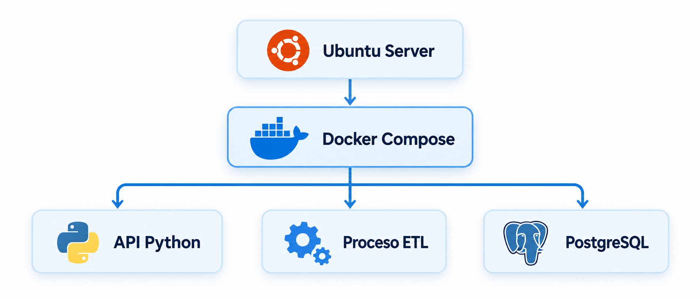
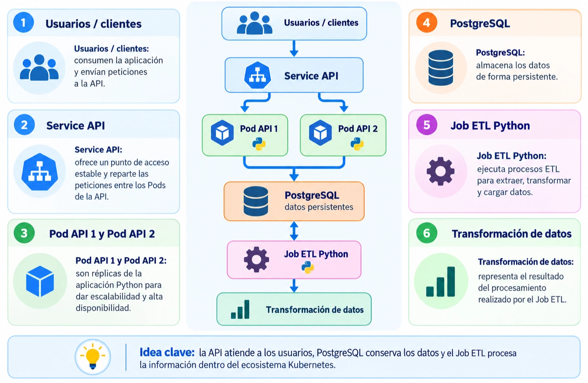

# 🧑🏽‍💻 Clase 49 - Introducción a Kubernetes

---

# 1. ¿De dónde venimos?

En las clases anteriores hemos visto:

- Ejecutar y administrar contenedores con **Docker**.
- Conservar datos usando **Docker Volumes** y compartir archivos usando **Bind Mounts**.
- Comunicar contenedores mediante **Docker Networks**.
- Construir imágenes propias con un **Dockerfile**.
- Levantar una aplicación con varios servicios usando **Docker Compose**.

---

En la **Clase 48** construimos aplicaciones con **Python y PostgreSQL** y realizamos un pequeño proceso **ETL**. Con `docker compose up -d` podíamos iniciar el conjunto de servicios, y con `docker compose down` detenerlo y retirar los recursos del proyecto.

Esto funciona muy bien para aprender, desarrollar y probar aplicaciones, especialmente cuando trabajamos en **un único servidor**.

**Pregunta:** ¿Qué ocurre si nuestra aplicación recibe muchas peticiones, falla un servidor o necesitamos ejecutarla de forma confiable en varios equipos? Ahí comienza el siguiente tema: **Kubernetes**.

---

# 2. ¿Qué problema resuelve Kubernetes?

Imaginemos una plataforma de datos formada por:

1. Una **API Python** que recibe peticiones.
2. Un **proceso ETL** que transforma los datos.
3. Una **base de datos PostgreSQL** que los almacena.
4. Un **servicio de inferencia** que utiliza un modelo de Machine Learning.

---

Inicialmente, podemos ejecutar estos componentes en un Ubuntu Server usando Docker Compose:



---

Pero una aplicación real puede necesitar:

- **Varias réplicas** de la API para atender más usuarios.
- **Recuperación** automática cuando falla un contenedor.
- **Distribución** de cargas entre varios servidores.
- **Actualizaciones** graduales sin interrumpir completamente el servicio.
- **Configuración** y almacenamiento administrados de forma consistente.

> **Idea clave:** Kubernetes permite coordinar la ejecución de aplicaciones contenedorizadas, especialmente cuando crecen en complejidad y necesitan automatización.
> 

<aside>
💡

**Importante:** Kubernetes no sustituye a Dockerfile ni al concepto de imagen. Seguiremos construyendo imágenes y ejecutándolas en contenedores. Kubernetes se ocupa de gestionar su despliegue y funcionamiento en un clúster.

</aside>

---

# 3. ¿Qué es Kubernetes?

**Kubernetes**, también llamado **K8s**, es una plataforma de código abierto para automatizar el **despliegue**, la **escalabilidad** y la **gestión** de aplicaciones contenedorizadas.

El nombre abreviado `K8s` viene de las ocho letras que hay entre la `K` y la `s` de Kubernetes.

Kubernetes permite declarar, por ejemplo:

> Quiero que mi aplicación Python tenga **tres réplicas** funcionando.
> 

A partir de esa definición, Kubernetes intenta mantener ese estado, incluso cuando falla alguna de las réplicas.

---

## 3.1. ¿Qué significa «orquestación»?

> Orquestar contenedores significa administrar de forma coordinada las aplicaciones que se ejecutan en ellos.
> 

Algunas tareas de un orquestador son:

| Necesidad | ¿Qué puede hacer Kubernetes? |
| --- | --- |
| Ejecutar una aplicación | Crear Pods a partir de las imágenes indicadas. |
| Aumentar capacidad | Ejecutar más réplicas de una aplicación. |
| Recuperarse de fallos | Reemplazar Pods que desaparecen o dejan de cumplir el estado esperado. |
| Permitir comunicación | Proporcionar Services y descubrimiento de servicios. |
| Actualizar una aplicación | Aplicar nuevas versiones gradualmente mediante un Deployment. |
| Organizar recursos | Separar grupos de trabajo mediante Namespaces. |

---

> **Matiz importante:** Kubernetes no garantiza que una aplicación mal programada funcione correctamente. Automatiza su gestión, pero debemos configurar correctamente la aplicación, los recursos y las comprobaciones de salud.
> 

---

# 4. Docker Compose vs. Kubernetes

> Conocemos Docker Compose como herramienta para definir varios servicios usando `compose.yaml`. Kubernetes utiliza una API y recursos declarativos que normalmente definimos en ficheros YAML.
> 

---

| Característica | Docker Compose | Kubernetes |
| --- | --- | --- |
| Entorno habitual | Desarrollo y despliegues sencillos | Entornos con mayores necesidades de operación y escalado |
| Unidad de trabajo | Servicios y contenedores | Objetos como Pods, Deployments y Services |
| Varios servidores | No es su ámbito principal | Sí: clúster de nodos |
| Réplicas | Puede iniciar varias instancias | Mantiene y reconcilia el número deseado |
| Autorrecuperación | Reinicios configurables, limitados al host | Controladores que reemplazan Pods según el estado deseado |
| Exposición de red | Puertos, redes y nombres de servicios | Services, DNS y otros mecanismos |
| Configuración | `compose.yaml` y variables | YAML de recursos, ConfigMaps y Secrets |
| Complejidad inicial | Menor | Mayor |

---

<aside>
💡

**¿Es Kubernetes siempre mejor?** No. Para una práctica local, un pipeline pequeño o un prototipo, **Docker Compose puede ser suficiente**. Kubernetes tiene sentido cuando necesitamos sus capacidades adicionales y estamos dispuestos a administrar esa complejidad.

</aside>

> **¿Podemos utilizar ambos?** Sí. Un equipo puede utilizar Compose durante el desarrollo y Kubernetes para determinados despliegues. Eso no significa que un fichero `compose.yaml` sea directamente equivalente a un manifiesto Kubernetes: los modelos y recursos son diferentes.
> 

---

# 5. Arquitectura de Kubernetes

Un **clúster de Kubernetes** es un conjunto de máquinas, físicas o virtuales, que colaboran para ejecutar aplicaciones.

Cada máquina del clúster se denomina **nodo (Node)**.

En un clúster distinguimos dos grandes partes:

1. **Control Plane**: controla y coordina el funcionamiento del clúster.
2. **Worker Nodes**: ejecutan las cargas de trabajo de nuestras aplicaciones.

---


---


<aside>
💡

**Observación:** Es una representación conceptual; un clúster real puede tener más nodos, control planes replicados y componentes de red adicionales.

</aside>

---

Visión mas realista


---

## 5.1. Control Plane

Es el conjunto de componentes que administra el clúster.

| Componente | Función principal |
| --- | --- |
| `kube-apiserver` | Expone la API de Kubernetes; recibe las solicitudes de administración. |
| `etcd` | Almacena de forma consistente los datos de configuración y el estado del clúster. |
| `kube-scheduler` | Decide en qué nodo puede ejecutarse un Pod que aún no tiene nodo asignado. |
| `kube-controller-manager` | Ejecuta controladores que comparan el estado real con el deseado y actúan cuando es necesario. |

**Ejemplo:** Pedimos tres réplicas de una API. El Control Plane registra ese estado deseado y coordina la creación y asignación de los Pods correspondientes.

---

## 5.2. Worker Node

Es la máquina donde se ejecutan los Pods de nuestras aplicaciones.

Componentes fundamentales:

- **`kubelet`**: agente del nodo que se encarga de que los Pods asignados se ejecuten según su especificación.
- **Container runtime**: software que ejecuta los contenedores; por ejemplo, **containerd** o **CRI-O**.
- **`kube-proxy`**: componente que, en configuraciones que lo utilizan, gestiona reglas de red para los Services. Algunas soluciones de red implementan esta función de otra manera.

> **Importante: Docker y Kubernetes.** Kubernetes moderno se comunica con el runtime mediante la **Container Runtime Interface (CRI)**. No necesita Docker Engine como runtime. Las imágenes que construimos con Docker pueden seguir utilizándose en Kubernetes siempre que sean compatibles y accesibles desde un registro o desde los nodos.
> 

---

# 6. ¿Qué es un Pod?

El **Pod** es la unidad desplegable más pequeña de Kubernetes.

Un Pod contiene **uno o varios contenedores** que comparten ciertos recursos, como una dirección IP y volúmenes definidos en el Pod.

En la mayoría de nuestros ejemplos iniciales, un Pod tendrá **un único contenedor**.

---


---

## 6.1. Pod no es lo mismo que contenedor

| Concepto | Significado |
| --- | --- |
| Imagen Docker | Artefacto que contiene la aplicación y su entorno. |
| Contenedor | Ejecución aislada de una imagen. |
| Pod | Recurso Kubernetes que agrupa y ejecuta uno o más contenedores. |

---


<aside>

Normalmente no administramos Pods individuales manualmente en aplicaciones de larga duración. Utilizamos un **Deployment** para que Kubernetes los cree y mantenga.

</aside>

---

# 7. ¿Qué es un Deployment?

Un **Deployment** permite describir y administrar una aplicación normalmente sin estado (*stateless*) mediante Pods replicados.

Entre sus funciones están:

- Establecer cuántas **réplicas** queremos.
- Mantener esa cantidad mientras sea posible.
- Realizar **actualizaciones graduales** de los Pods.
- Permitir volver a una versión anterior del Deployment en determinados casos.

---

Ejemplo:


---


---

Si se elimina uno de los Pods administrados por el Deployment, Kubernetes intentará crear otro hasta recuperar las tres réplicas solicitadas.

**No confundir:** tres réplicas no implican necesariamente tres servidores diferentes. El scheduler decide la ubicación teniendo en cuenta los recursos y restricciones configurados.

---

# 8. ¿Qué es un Service?

Los Pods pueden ser creados y reemplazados; por ello, **no debemos depender de una dirección IP concreta de un Pod**.

Un **Service** proporciona una forma estable de acceder a un conjunto de Pods, generalmente seleccionados mediante etiquetas (*labels*).

---


---

## 8.1. Tipos frecuentes de Service

| Tipo | Para qué se utiliza |
| --- | --- |
| `ClusterIP` | Publica el servicio dentro del clúster; es el tipo predeterminado. |
| `NodePort` | Expone el servicio en un puerto de los nodos. |
| `LoadBalancer` | Solicita un balanceador externo cuando el entorno ofrece esa integración. |

---


<aside>

Para comenzar utilizaremos **ClusterIP** y accederemos desde nuestro equipo mediante `kubectl port-forward` cuando tengamos instalado el clúster.

</aside>

---

# 9. Otros recursos

## 9.1. Namespace

Un **Namespace** permite organizar y separar de forma lógica muchos recursos de un clúster.

Ejemplo:

```
Kubernetes Cluster
├── namespace: desarrollo
│   └── api-python
└── namespace: produccion
    └── api-python
```

Los Namespaces ayudan a organizar, pero **no constituyen por sí solos una frontera completa de seguridad**.

---

## 9.2. ConfigMap

Almacena configuración **no confidencial**, por ejemplo:

```
APP_ENV=development
LOG_LEVEL=INFO
```

---

## 9.3. Secret

Permite gestionar datos confidenciales, como credenciales o tokens, que una aplicación necesita.

> **Seguridad:** un Secret no equivale automáticamente a cifrado de extremo a extremo. El contenido puede quedar almacenado o expuesto si no configuramos adecuadamente cifrado en reposo, permisos RBAC y procedimientos de acceso. La codificación Base64 de un manifiesto no es cifrado.
> 

---

## 9.4. PersistentVolume y PersistentVolumeClaim

Los Pods son reemplazables; los datos de una base de datos no deben depender exclusivamente de su almacenamiento temporal.

- **PersistentVolume (PV)**: recurso que representa almacenamiento disponible para el clúster.
- **PersistentVolumeClaim (PVC)**: solicitud de almacenamiento realizada por una aplicación.

---


---

Es una evolución conceptual de lo que ya conocemos de **Docker Volumes**, aunque la gestión de almacenamiento de Kubernetes tiene un modelo propio.

---

## 9.5. StatefulSet y Job

Dos recursos especialmente útiles para Ingeniería de Datos:

- **StatefulSet**: controla la identidad y el almacenamiento estable de aplicaciones con estado, como determinadas instalaciones de bases de datos.
- **Job**: ejecuta una tarea hasta su finalización; útil para una transformación ETL o un procesamiento por lotes.

También existe **CronJob**, que permite programar Jobs periódicamente. Los estudiaremos más adelante.

---


---

# 10. Kubernetes es declarativo

En Docker hemos utilizado instrucciones como:

```bash
docker run -d --name nginx-prueba -p 8080:80 nginx
```

En Kubernetes podemos describir **cómo queremos que esté** la aplicación utilizando YAML. Por ejemplo, definimos:

```yaml
replicas:3
```

Esto significa que queremos tres réplicas del recurso correspondiente. Kubernetes observa el estado real y trata de ajustarlo al estado deseado.

---


Este proceso se denomina **reconciliación (Reconciliation Loop)**.

**Diferencia fundamental:** Kubernetes no es solo una colección de comandos. Es un sistema que mantiene y reconcilia estados declarados a través de su API.

---

# 11. Nuestro primer manifiesto Kubernetes

Un **manifiesto** es un archivo YAML que declara un objeto Kubernetes. Vamos a estudiar el siguiente fichero, llamado `deployment.yaml`:

```yaml
apiVersion: apps/v1
kind: Deployment
metadata:
name: nginx-clase49
spec:
replicas:2
selector:
matchLabels:
app: nginx-clase49
template:
metadata:
labels:
app: nginx-clase49
spec:
containers:
-name: nginx
image: nginx:1.27-alpine
ports:
-containerPort:80
```

---


---

> **Nota de versiones:** La etiqueta de imagen es un ejemplo didáctico. En proyectos reales, hay que verificar que la etiqueta elegida esté disponible y, cuando se necesite reproducibilidad fuerte, fijar una versión o un digest concreto.
> 

---

## 11.1. Interpretación de las instrucciones

| Campo | Significado |
| --- | --- |
| `apiVersion: apps/v1` | Versión de la API para este recurso. |
| `kind: Deployment` | Tipo de objeto que creamos. |
| `metadata.name` | Nombre del Deployment. |
| `spec.replicas: 2` | Cantidad deseada de Pods. |
| `selector.matchLabels` | Etiquetas que identifican los Pods controlados. |
| `template` | Plantilla utilizada para crear los Pods. |
| `containers` | Contenedores que ejecutará cada Pod. |
| `image` | Imagen utilizada. |
| `containerPort: 80` | Puerto declarado del contenedor; **no lo publica automáticamente fuera del clúster**. |

**Atención a la indentación:** YAML utiliza espacios. No debemos sustituirlos por tabulaciones.

---

# 12. Publicar la aplicación con un Service

Ahora creamos `service.yaml`:

```yaml
apiVersion: v1
kind: Service
metadata:
name: nginx-clase49
spec:
type: ClusterIP
selector:
app: nginx-clase49
ports:
-name: http
port:80
targetPort:80
protocol: TCP
```

---

El campo:

```yaml
selector:
app: nginx-clase49
```

selecciona los Pods que tienen esa etiqueta.

---

**Relación:**


El Service proporciona acceso a los Pods correspondientes, sin exigir que conozcamos sus IP individuales.

---

# 13. Introducción a kubectl

<aside>

**`kubectl`** es la herramienta de línea de comandos que permite comunicarnos con la API de Kubernetes.

</aside>

---

Algunos comandos básicos son:

| Comando | Función |
| --- | --- |
| `kubectl version --client` | Comprueba la versión del cliente instalado. |
| `kubectl cluster-info` | Muestra información del clúster configurado. |
| `kubectl get nodes` | Lista nodos. |
| `kubectl get pods` | Lista Pods del Namespace actual. |
| `kubectl get deployments` | Lista Deployments. |
| `kubectl get services` | Lista Services. |
| `kubectl describe pod NOMBRE` | Describe un Pod y sus eventos. |
| `kubectl logs POD` | Muestra registros de un Pod. |
| `kubectl apply -f deployment.yaml` | Crea o actualiza los recursos descritos en un manifiesto. |
| `kubectl delete -f deployment.yaml` | Elimina los recursos descritos en el manifiesto. |

---

**Importante:** Estos comandos que consultan el clúster requieren un **clúster Kubernetes accesible** y un fichero `kubeconfig` válido. Instalar solo `kubectl` no crea un clúster.

---

# 14. Laboratorio 1 — Leer un manifiesto sin instalar Kubernetes

> **Objetivo:** Familiarizarse con YAML, los recursos Deployment y Service y sus etiquetas. **Este laboratorio sí puede realizarse con el Ubuntu Server preparado en las clases anteriores, sin clúster.**
> 

---

## Paso 1. Conectarse a Ubuntu Server

Desde Windows, abrir **VS Code** y conectarse con **Remote - SSH** al Ubuntu Server preparado en la Clase 43.

Abrir la terminal integrada y comprobar:

```bash
whoami
hostname
pwd
```

---

## Paso 2. Crear el proyecto

```bash
mkdir -p ~/proyectos/kubernetes-clase49
cd ~/proyectos/kubernetes-clase49
```

---

## Paso 3. Crear los archivos

```bash
touch deployment.yaml service.yaml
```

Copiar en cada archivo su manifiesto correspondiente de las secciones 11 y 12.

---

## Paso 4. Revisar los ficheros

```bash
ls -lah
cat deployment.yaml
cat service.yaml
```

---

Comprobar lo siguiente:

1. El Deployment solicita **2 réplicas**.
2. El contenedor utiliza la imagen de **Nginx**.
3. Las etiquetas `app: nginx-clase49` son iguales en el `selector` del Deployment, en la plantilla de los Pods y en el `selector` del Service.
4. El Service utiliza el tipo `ClusterIP`.
5. Ninguna de estas acciones **ha arrancado un contenedor**: de momento solo hemos creado archivos declarativos.

**Resultado esperado:** dos archivos YAML listos para ser aplicados en un clúster más adelante.

---

# 15. Laboratorio 2 — Ejecutar Nginx cuando tengamos un clúster

> **Requisito:** Este laboratorio es **condicional**. Solo se ejecutará cuando se haya preparado un clúster Kubernetes local o remoto, `kubectl` esté instalado y el cliente tenga acceso al clúster.
> 

---

## Paso 1. Verificar conexión

```bash
kubectl cluster-info
kubectl get nodes
```

**Resultado esperado:** `kubectl` responde y aparece al menos un nodo con estado `Ready`.

---

## Paso 2. Aplicar los manifiestos

Desde `~/proyectos/kubernetes-clase49`:

```bash
kubectl apply -f deployment.yaml
kubectl apply -f service.yaml
```

También podríamos aplicar todos los YAML de la carpeta mediante `kubectl apply -f .`, siempre que contenga solamente manifiestos válidos y previstos.

---

## Paso 3. Comprobar el estado

```bash
kubectl get deployments
kubectl get pods -o wide
kubectl get services
```

Debemos observar un Deployment `nginx-clase49`, **dos Pods** asociados (si el clúster puede programarlos) y el Service correspondiente. Los Pods pueden tardar un poco en alcanzar `Running` y estar listos.

---

## Paso 4. Acceder a Nginx

Para probar Nginx desde la **terminal de Ubuntu Server**:

```bash
kubectl port-forward service/nginx-clase49 8080:80
```

El proceso permanecerá en primer plano. En **otra terminal del mismo Ubuntu Server**:

```bash
curl http://127.0.0.1:8080
```

Deberíamos recibir HTML de la página de Nginx.

---

> **Acceso desde Windows:** `127.0.0.1:8080` en este ejemplo corresponde al Ubuntu Server remoto, no necesariamente al equipo Windows. Para verlo en el navegador de Windows podemos usar el reenvío de puertos de VS Code Remote - SSH o un túnel SSH adicional, según la configuración del alumno. No exponer el puerto de manera indiscriminada.
> 

---

## Paso 5. Aumentar réplicas

En una terminal diferente de la que ejecuta `port-forward`:

```bash
kubectl scale deployment nginx-clase49 --replicas=3
kubectl get pods
```

Verificar que Kubernetes intenta tener tres Pods.

<aside>

**Importante:** `kubectl scale` modifica el estado deseado en el clúster, pero no cambia el archivo `deployment.yaml`. Si posteriormente aplicamos otra vez el manifiesto original con `replicas: 2`, podemos volver a las dos réplicas. Para conservar el cambio en el material declarativo, modificar también el YAML.

</aside>

---

## Paso 6. Comprobar la autorrecuperación

Listar los Pods:

```bash
kubectl get pods
```

Elegir el nombre exacto de uno de los Pods de Nginx y ejecutar:

```bash
kubectl delete pod NOMBRE_DEL_POD
kubectl get pods -w
```

---

**No se debe copiar `NOMBRE_DEL_POD` literalmente.** Sustituirlo por un nombre real obtenido en el comando anterior.

El Deployment intentará crear un Pod de reemplazo para mantener las réplicas deseadas. Detener la observación con `Ctrl + C`.

---

## Paso 7. Limpiar los recursos

Primero detener el `port-forward` con `Ctrl + C`. Después ejecutar:

```bash
kubectl delete -f service.yaml
kubectl delete -f deployment.yaml
```

Revisar:

```bash
kubectl get deployments
kubectl get pods
kubectl get services
```

<aside>

**Precaución:** Estos comandos borran los recursos descritos en nuestros archivos y en el Namespace actual. No se deben ejecutar sobre manifiestos ajenos o entornos de producción sin revisar su efecto.

</aside>

---

# 16. Kubernetes aplicado a Ingeniería de Datos e IA

Vamos a recuperar el ejemplo trabajado en la Clase 48: **Python + PostgreSQL + ETL**.

En Kubernetes podríamos evolucionarlo de este modo:



---

Asociación conceptual de cada necesidad:

| Necesidad de la plataforma | Recurso posible |
| --- | --- |
| Ejecutar varias réplicas de una API | Deployment |
| Proporcionar una dirección estable a la API | Service |
| Ejecutar una carga ETL puntual | Job |
| Programar una carga diaria | CronJob |
| Guardar parámetros no sensibles | ConfigMap |
| Suministrar credenciales | Secret |
| Solicitar almacenamiento persistente | PersistentVolumeClaim |
| Gestionar identidades estables de Pods con estado | StatefulSet |

<aside>

**Aclaración:** Para PostgreSQL real puede ser preferible un servicio de base de datos gestionado u otra arquitectura específica. No basta con crear un StatefulSet y un volumen para disponer de copias de seguridad, alta disponibilidad y recuperación ante desastres.

</aside>

---

## 16.1. ¿Qué cambia respecto a Docker Compose?

En Compose describimos servicios de una aplicación y su ejecución en un entorno Docker. En Kubernetes dividimos el diseño en recursos especializados que trabajan coordinadamente.

En las siguientes clases aprenderemos a traducir **necesidades** —no necesariamente líneas exactas de `compose.yaml`— a objetos Kubernetes.

---

# 17. Ejercicios de comprensión

Responde antes de consultar las soluciones:

1. ¿Qué diferencia principal existe entre Docker Compose y Kubernetes?
2. ¿Qué es un clúster Kubernetes?
3. ¿Qué diferencia existe entre Control Plane y Worker Node?
4. ¿Por qué un Pod no es exactamente lo mismo que un contenedor?
5. ¿Qué recurso utilizarías para mantener tres réplicas de una API Python?
6. ¿Por qué resulta útil un Service cuando se reemplazan los Pods?
7. ¿Qué recurso utilizarías para una tarea ETL que debe terminar al completar su trabajo?
8. ¿Qué recurso permite ejecutar tareas de datos periódicamente?
9. ¿Es necesario Docker Engine para que Kubernetes ejecute contenedores?
10. ¿Por qué instalar `kubectl` no es suficiente para ejecutar `kubectl get nodes` correctamente?
- Soluciones orientativas
    1. Compose administra aplicaciones definidas como servicios en un entorno Docker; Kubernetes administra recursos contenedorizados mediante una API y controladores, generalmente en clústeres.
    2. Un conjunto de nodos y componentes Kubernetes que colaboran para ejecutar y gestionar cargas de trabajo.
    3. El Control Plane coordina y administra; los Workers ejecutan las cargas.
    4. Un Pod puede agrupar uno o más contenedores y dispone de recursos y ciclo de vida propios.
    5. Deployment.
    6. Ofrece una forma estable de localizar los Pods seleccionados aunque se reemplacen.
    7. Job.
    8. CronJob.
    9. No. Puede usar runtimes compatibles con CRI, como containerd.
    10. Necesitamos además un clúster accesible y configuración de acceso válida.

---

# 19. Próxima clase — Preparar nuestro primer clúster Kubernetes

En la siguiente clase podremos trabajar, paso a paso, la **instalación y configuración de un clúster de laboratorio** compatible con el entorno que ya utilizamos: Ubuntu Server 24.04 en una máquina virtual y acceso mediante VS Code Remote - SSH.

Antes de elegir una herramienta (por ejemplo, **Minikube**, **kind** o **K3s**) evaluaremos requisitos de memoria, CPU, compatibilidad con el entorno de virtualización y qué componentes deseamos enseñar. **No todas estas herramientas se instalan ni se administran de la misma manera.**

A partir de entonces podremos ejecutar realmente los manifiestos creados en la Clase 49, inspeccionar Pods y experimentar con réplicas y autorrecuperación.

---