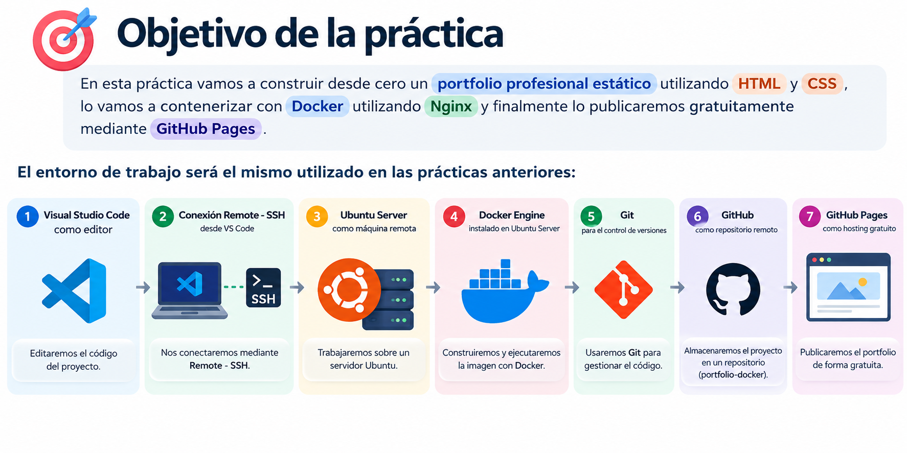

# Práctica : Portfolio profesional con Docker + GitHub Pages

## Objetivo de la práctica




---

# 1. Arquitectura de la práctica

El flujo de trabajo será el siguiente:


---

# 2. Resultado que vamos a obtener

Crearemos una página sencilla de portfolio con las siguientes secciones:

- Presentación.
- Sobre mí.
- Tecnologías.
- Proyectos.
- Contacto.

La estructura final del proyecto será:

```
portfolio-docker/
│
├── index.html
│
├── css/
│   └── styles.css
│
├── images/
│   ├── foto-perfil.jpg
│   ├── pipeline-datos.png
│   ├── modelo-ml.png
│   └── dashboard-ventas.png
│
├── Dockerfile
├── .dockerignore
├── .gitignore
└── README.md
```

---

---

# 3. Crear el repositorio en GitHub

Comenzaremos creando primero el repositorio remoto.

Entramos en:

```
https://github.com
```

Pulsamos:

```
New repository
```

Configuramos el repositorio:

```
Repository name:
portfolio-docker
```

Descripción sugerida:

```
Portfolio profesional estático contenedorizado con Docker y publicado con GitHub Pages.
```

Para poder utilizar GitHub Pages gratuitamente con GitHub Free utilizaremos un repositorio:

```
Public
```

Para simplificar la práctica podemos crear inicialmente el repositorio **vacío**, sin añadir:

```
README
.gitignore
License
```

Finalmente pulsamos:

```
Create repository
```

GitHub mostrará la URL del repositorio.

Por ejemplo:

```
git@github.com:usuario/portfolio-docker.git
```

> Sustituiremos `usuario` por nuestro nombre real de usuario de GitHub.
> 

---

# 4. Conectar VS Code al Ubuntu Server

Abrimos Visual Studio Code.

Utilizamos la extensión:

```
Remote - SSH
```

Desde la paleta de comandos:

```
Ctrl + Shift + P
```

Seleccionamos:

```
Remote-SSH: Connect to Host...
```

Elegimos nuestro Ubuntu Server.

Cuando VS Code esté conectado, abrimos una terminal integrada:

```
Terminal -> New Terminal
```

A partir de este momento, los comandos se ejecutarán **en Ubuntu Server**.

Podemos verificarlo con:

```bash
hostname
```

Y comprobar el sistema operativo:

```bash
cat /etc/os-release
```

---

# 5. Comprobar Docker Engine

Antes de comenzar comprobaremos que Docker está disponible.

```bash
docker --version
```

Por ejemplo:

```
Docker version 28.x.x
```

Comprobamos que el daemon responde:

```bash
docker info
```

También podemos ejecutar:

```bash
docker ps
```

Si no aparecen errores, Docker está preparado.

---

# 6. Crear la carpeta del proyecto

Desde la terminal remota:

```bash
mkdir -p ~/proyectos
cd ~/proyectos
```

Creamos el proyecto:

```bash
mkdir portfolio-docker
cd portfolio-docker
```

Abrimos la carpeta actual en VS Code:

```bash
code .
```

> Si estamos trabajando mediante VS Code Remote - SSH, el explorador de archivos mostrará los ficheros almacenados en Ubuntu Server.
> 

---

# 7. Inicializar Git

Dentro de la carpeta:

```bash
git init
```

Establecemos `main` como rama principal:

```bash
git branch -M main
```

Comprobamos:

```bash
git status
```

Resultado esperado:

```
On branch main

No commits yet
```

---

# 8. Crear la estructura de carpetas

Desde la terminal:

```bash
mkdir -p css images
touch index.html
touch css/styles.css
touch Dockerfile
touch .dockerignore
touch .gitignore
touch README.md
```

**Antes de construir Docker**, coloca en `images/` cuatro imágenes con los nombres indicados. En el ZIP de plantilla que acompaña esta práctica se incluyen imágenes demostrativas listas para utilizar. El alumno puede reemplazarlas por su foto y capturas reales desde el explorador de VS Code Remote-SSH. Para usar las mismas imágenes del zip basta con arrastrar las fotos hasta la carpeta images.

Comprobamos la estructura:

```bash
find . -maxdepth 2 -type f
```

Deberíamos obtener algo parecido a:

```
./index.html
./css/styles.css
./images/foto-perfil.jpg
./images/pipeline-datos.png
./images/modelo-ml.png
./images/dashboard-ventas.png
./Dockerfile
./.dockerignore
./.gitignore
./README.md
```

---

# 9. Crear `index.html`

Abrimos `index.html` en VS Code y añadimos:

```html
<!DOCTYPE html>
<html lang="es">

<head>
    <meta charset="UTF-8">
    <meta name="viewport" content="width=device-width, initial-scale=1.0">

    <meta
        name="description"
        content="Portfolio profesional de un especialista en Ingeniería de Datos, Inteligencia Artificial y Cloud."
>

    <title>Portfolio | Data & AI Engineer</title>

    <link rel="stylesheet" href="css/styles.css">
</head>

<body>

    <header class="hero">

        <nav class="navbar">
            <div class="container navbar-content">

                <a class="logo" href="#inicio">
                    DataPortfolio
                </a>

                <div class="nav-links">
                    <a href="#sobre-mi">Sobre mí</a>
                    <a href="#skills">Tecnologías</a>
                    <a href="#proyectos">Proyectos</a>
                    <a href="#contacto">Contacto</a>
                </div>

            </div>
        </nav>

        <section id="inicio" class="container hero-content">

            

            <p class="eyebrow">
                DATA · AI · CLOUD · DEVOPS
            </p>

            <h1>
                Hola, soy Alex
            </h1>

            <h2>
                Data & AI Engineer
            </h2>

            <p class="hero-description">
                Diseño soluciones de datos e Inteligencia Artificial
                utilizando Python, Docker, Kubernetes y tecnologías Cloud.
            </p>

            <div class="hero-actions">

                <a class="button primary" href="#proyectos">
                    Ver proyectos
                </a>

                <a class="button secondary" href="#contacto">
                    Contactar
                </a>

            </div>

        </section>

    </header>

    <main>

        <section id="sobre-mi" class="section">

            <div class="container">

                <p class="section-label">
                    SOBRE MÍ
                </p>

                <h2>
                    Ingeniería de Datos e Inteligencia Artificial
                </h2>

                <p class="section-text">
                    Soy un profesional especializado en el desarrollo de
                    soluciones de datos, automatización, Machine Learning
                    y despliegue de aplicaciones mediante contenedores.
                </p>

                <p class="section-text">
                    Me interesa especialmente construir sistemas
                    reproducibles, escalables y fáciles de desplegar.
                </p>

            </div>

        </section>

        <section id="skills" class="section section-alt">

            <div class="container">

                <p class="section-label">
                    TECNOLOGÍAS
                </p>

                <h2>
                    Stack tecnológico
                </h2>

                <div class="cards">

                    <article class="card">
                        <h3>Data Engineering</h3>
                        <p>
                            Python, SQL, ETL, APIs, pipelines y procesamiento
                            de datos.
                        </p>
                    </article>

                    <article class="card">
                        <h3>Artificial Intelligence</h3>
                        <p>
                            Machine Learning, modelos predictivos,
                            experimentación y aplicaciones de IA.
                        </p>
                    </article>

                    <article class="card">
                        <h3>Cloud & DevOps</h3>
                        <p>
                            Docker, Kubernetes, Linux, Git, GitHub
                            y automatización de despliegues.
                        </p>
                    </article>

                </div>

            </div>

        </section>

        <section id="proyectos" class="section">

            <div class="container">

                <p class="section-label">
                    PROYECTOS
                </p>

                <h2>
                    Algunos trabajos
                </h2>

                <div class="projects">

                    <article class="project">

                        

                        <span class="project-number">
                            01
                        </span>

                        <h3>
                            Pipeline de datos
                        </h3>

                        <p>
                            Pipeline ETL desarrollado en Python y ejecutado
                            dentro de contenedores Docker.
                        </p>

                    </article>

                    <article class="project">

                        

                        <span class="project-number">
                            02
                        </span>

                        <h3>
                            API de Machine Learning
                        </h3>

                        <p>
                            Modelo de Machine Learning expuesto mediante
                            una API y preparado para despliegue en Kubernetes.
                        </p>

                    </article>

                    <article class="project">

                        

                        <span class="project-number">
                            03
                        </span>

                        <h3>
                            Plataforma de analítica
                        </h3>

                        <p>
                            Arquitectura para ingestión, procesamiento
                            y visualización de información empresarial.
                        </p>

                    </article>

                </div>

            </div>

        </section>

        <section id="contacto" class="section section-dark">

            <div class="container">

                <p class="section-label">
                    CONTACTO
                </p>

                <h2>
                    ¿Hablamos?
                </h2>

                <p>
                    Puedes encontrarme en GitHub o contactar conmigo
                    mediante correo electrónico.
                </p>

                <div class="contact-links">

                    <a
                        class="button primary"
                        href="https://github.com/usuario"
                        target="_blank"
                        rel="noopener noreferrer"
>
                        GitHub
                    </a>

                    <a
                        class="button secondary light"
                        href="mailto:correo@ejemplo.com"
>
                        Email
                    </a>

                </div>

            </div>

        </section>

    </main>

    <footer>

        <div class="container footer-content">

            <p>
                Portfolio profesional
            </p>

            <p>
                Construido con HTML, CSS, Docker y GitHub Pages.
            </p>

        </div>

    </footer>

</body>

</html>
```

## Personalización

Antes de publicar, cambia como mínimo:

```
Alex
usuario
correo@ejemplo.com
```

por tus propios datos.

---

# 10. Crear `css/styles.css`

Abrimos:

```
css/styles.css
```

y añadimos:

---

# 10.1. Personalizar las imágenes del portfolio

La plantilla incluye la carpeta `images/` y cuatro archivos gráficos de ejemplo. **No representan proyectos reales ni una persona real:** son recursos ilustrativos que cada estudiante debe sustituir.

| Archivo | Uso en la web | Recomendación |
| --- | --- | --- |
| `images/foto-perfil.jpg` | Foto circular en la cabecera | JPG cuadrado, por ejemplo 600 × 600 px |
| `images/pipeline-datos.png` | Proyecto de ETL | Captura o diagrama PNG |
| `images/modelo-ml.png` | Proyecto de IA | Resultados o gráfica del modelo |
| `images/dashboard-ventas.png` | Proyecto de analítica | Captura de Power BI, Tableau, etc. |

Para cambiar una imagen: arrástrala desde tu equipo al directorio `images/` del explorador de VS Code conectado por SSH; renómbrala con el nombre del ejemplo correspondiente (o ajusta la ruta `src` de `index.html`). No se necesita editar el `Dockerfile` después de cada sustitución: basta con volver a construir la imagen.

Ejemplo de uso en HTML:

```html

```

Las rutas son **relativas**, por lo que sirven en Docker y en GitHub Pages, incluso cuando el sitio se publica bajo `/portfolio-docker/`. Utiliza imágenes propias o con derechos de uso y evita capturas con información personal o empresarial confidencial. Comprime las imágenes para que la web cargue rápido.

> **Importante:** Docker requiere que los cuatro archivos existan al ejecutar `docker build`. El material de inicio descargable incluye los cuatro archivos de muestra. Si trabajas únicamente con este Markdown, debes añadir tus propias imágenes con esos nombres antes de construir.
> 

---

# 11. Comprobar la página antes de utilizar Docker

Como el proyecto solamente utiliza HTML y CSS, podemos comprobar rápidamente que los archivos existen:

```bash
ls -la
```

Y:

```bash
ls -la css
ls -la images
```

Todavía no necesitamos instalar Nginx directamente en Ubuntu.

Ese será precisamente uno de los objetivos de Docker:

```
NO instalar Nginx en el host
```

sino ejecutar Nginx dentro de un contenedor.

---

# 12. Crear el `Dockerfile`

Creamos el fichero:

```
Dockerfile
```

con el siguiente contenido:

```docker
FROM nginx:alpine

COPY index.html /usr/share/nginx/html/index.html

COPY css /usr/share/nginx/html/css

COPY images /usr/share/nginx/html/images

EXPOSE 80

CMD ["nginx", "-g", "daemon off;"]
```

---

# 13. Analizar el Dockerfile

## `FROM`

```docker
FROM nginx:alpine
```

Utilizamos una imagen oficial de Nginx basada en Alpine Linux.

El contenedor ya incluirá:

```
Linux userspace
Nginx
Configuración básica de Nginx
```

Por tanto, no necesitamos instalar Nginx manualmente.

> Para una práctica didáctica usamos `nginx:alpine`. En un proyecto de producción es recomendable fijar una versión concreta de la imagen para mejorar la reproducibilidad.
> 

---

## `COPY index.html`

```docker
COPY index.html /usr/share/nginx/html/index.html
```

Copiamos la página principal al directorio desde el que Nginx sirve páginas web.

---

## `COPY css`

```docker
COPY css /usr/share/nginx/html/css
```

Copiamos nuestra carpeta CSS dentro de la imagen.

---

## `COPY images`

```docker
COPY images /usr/share/nginx/html/images
```

Incluye la carpeta de fotografías y capturas en la imagen. Sin esta línea Nginx no podría servir las imágenes del portfolio dentro del contenedor.

---

## `EXPOSE`

```docker
EXPOSE 80
```

Documentamos que el servicio Nginx escucha en el puerto:

```
80/tcp
```

---

## `CMD`

```docker
CMD ["nginx", "-g", "daemon off;"]
```

Nginx se ejecutará en primer plano.

Esto es importante dentro de un contenedor porque el proceso principal debe permanecer activo.

---

# 14. Crear `.dockerignore`

Creamos:

```
.dockerignore
```

con:

```
.git
.gitignore
README.md
.vscode
.DS_Store
*.log
```

Su función es evitar que determinados archivos se incluyan dentro del **build context** enviado al Docker Engine.

Por ejemplo, no necesitamos copiar dentro de nuestra imagen:

```
.git/
README.md
ficheros del editor
logs
```

---

# 15. Crear `.gitignore`

Creamos:

```
.gitignore
```

con:

```
# VS Code
.vscode/

# Sistema operativo
.DS_Store
Thumbs.db

# Logs
*.log

# Archivos temporales
*.tmp
*.swp
```

En este caso nuestro proyecto es pequeño y estático, pero resulta útil mantener desde el principio una política clara sobre qué archivos no deben almacenarse en Git.

---

# 16. Crear `README.md`

Creamos:

```
README.md
```

con:

```markdown
# Portfolio Docker

Portfolio profesional estático desarrollado con HTML y CSS.

## Tecnologías

-HTML5
-CSS3
-Docker
-Nginx
-Git
-GitHub
-GitHub Pages

## Ejecutar con Docker

Construir la imagen:

```bash
docker build -t portfolio-web:1.0 .
```

Ejecutar:

```bash
docker run -d \
  --name portfolio-web \
  -p 8080:80 \
  portfolio-web:1.0
```

Abrir:

```
http://localhost:8080
```

## GitHub Pages

La versión pública del portfolio se publica desde la rama `main`.

```

---

# 17. Comprobar todos los archivos

Ejecutamos:

```bash
find . -maxdepth 2 -type f | sort
```

Resultado esperado:

```
./.dockerignore
./.gitignore
./Dockerfile
./README.md
./css/styles.css
./images/dashboard-ventas.png
./images/foto-perfil.jpg
./images/modelo-ml.png
./images/pipeline-datos.png
./index.html
```

---

# 18. Construir la imagen Docker

Desde la raíz del proyecto:

```bash
docker build -t portfolio-web:1.0 .
```

Docker realizará aproximadamente este proceso:

```
1. Leer Dockerfile
2. Descargar nginx:alpine si no existe localmente
3. Crear una nueva capa
4. Copiar index.html
5. Copiar css/
6. Copiar images/
7. Crear la imagen portfolio-web:1.0
```

Podemos comprobar la imagen:

```bash
docker image ls
```

Buscamos:

```
portfolio-web
```

---

# 19. Ejecutar el contenedor

Ejecutamos:

```bash
docker run -d \
  --name portfolio-web \
  -p 8080:80 \
  portfolio-web:1.0
```

Interpretación:

```
-d
```

Ejecuta el contenedor en segundo plano.

```
--name portfolio-web
```

Asigna un nombre al contenedor.

```
-p 8080:80
```

Mapea:

```
Puerto 8080 del Ubuntu Server
        ↓
Puerto 80 del contenedor
```

Finalmente:

```
portfolio-web:1.0
```

es la imagen que queremos ejecutar.

---

# 20. Comprobar el contenedor

Ejecutamos:

```bash
docker ps
```

Deberíamos observar algo parecido a:

```
CONTAINER ID   IMAGE                 PORTS
xxxxxxxxxxxx   portfolio-web:1.0     0.0.0.0:8080->80/tcp
```

También podemos comprobarlo desde Ubuntu:

```bash
curl http://localhost:8080
```

Si Nginx funciona correctamente obtendremos el HTML de nuestra página.

---

# 21. Abrir el portfolio desde nuestro ordenador

Estamos ejecutando Docker en un Ubuntu Server remoto.

Por tanto:

```
localhost:8080
```

desde nuestro navegador local no apunta automáticamente al Ubuntu Server.

Tenemos dos posibilidades.

## Opción recomendada: Port Forwarding de VS Code

En VS Code, en la parte inferior al lado de la Terminal buscamos la sección:

```
PORTS
```

Añadimos el puerto:

```
8080
```

VS Code creará un túnel SSH.

Podremos abrir el enlace que nos proporciona VS Code desde nuestro navegador local.

El flujo será:

```
Navegador local
      ↓
VS Code Port Forwarding
      ↓
SSH
      ↓
Ubuntu Server :8080
      ↓
Docker
      ↓
Nginx :80
```

Esta opción evita tener que exponer públicamente el puerto `8080` del servidor.

---

# 22. Consultar los logs del contenedor

Podemos inspeccionar los accesos a Nginx:

```bash
docker logs portfolio-webdocker
```

Para seguirlos en tiempo real:

```bash
docker logs -f portfolio-web
```

Cada vez que abramos la página podremos observar peticiones como:

```
GET / HTTP/1.1
GET /css/styles.css HTTP/1.1
```

Esto permite explicar que el navegador está solicitando diferentes recursos al servidor web.

---

# 23. Inspeccionar el contenedor

Podemos entrar temporalmente en el contenedor:

```bash
docker exec -it portfolio-web sh
```

Dentro:

```bash
ls -la /usr/share/nginx/html
```

Deberíamos observar:

```
index.html
css/
images/
```

Podemos incluso comprobar:

```bash
cat /usr/share/nginx/html/index.html
```

Salimos:

```bash
exit
```

---

# 24. Comparar host y contenedor

Este punto es especialmente importante para entender Docker.

En Ubuntu Server tenemos:

```
~/proyectos/portfolio-docker/index.html
```

Dentro del contenedor tenemos:

```
/usr/share/nginx/html/index.html
```

Durante el `docker build`, Docker creó una imagen que contiene una copia de nuestros ficheros.

Por tanto:

```
Código fuente
     ↓
docker build
     ↓
Imagen inmutable
     ↓
docker run
     ↓
Contenedor
```

---

# 25. Registrar el proyecto con Git

Comprobamos:

```bash
git status
```

Git mostrará los archivos todavía no versionados.

Añadimos todo:

```bash
git add .
```

Comprobamos:

```bash
git status
```

Creamos el primer commit:

```bash
git commit -m "feat: create Dockerized professional portfolio"
```

---

# 26. Conectar el proyecto con GitHub

Añadimos como remoto el repositorio creado al principio.

Usando SSH:

```bash
git remote add origin git@github.com:USUARIO/portfolio-docker.git
```

Sustituimos:

```
USUARIO
```

por nuestro usuario de GitHub.

Comprobamos:

```bash
git remote -v
```

Resultado esperado:

```
origin  git@github.com:USUARIO/portfolio-docker.git (fetch)
origin  git@github.com:USUARIO/portfolio-docker.git (push)
```

> Para utilizar esta URL SSH, la cuenta de GitHub debe tener configurada una clave SSH correspondiente al Ubuntu Server.
> 

---

# 27. Subir el proyecto a GitHub

Ejecutamos:

```bash
git push -u origin main
```

Ahora podemos recargar el navegador en GitHub.

Deberíamos ver:

```
index.html
css/
Dockerfile
.dockerignore
.gitignore
README.md
```

---

# 28. Importante: ¿qué hará GitHub Pages con Docker?

En este punto tenemos un repositorio que contiene tanto:

```
index.html
css/
images/
```

como:

```
Dockerfile
.dockerignore
```

Sin embargo, GitHub Pages no hará:

```
docker build
docker run
```

GitHub Pages funciona como **hosting de contenido estático**.

Por tanto publicará:

```
index.html
css/styles.css
```

Nuestro Dockerfile seguirá siendo parte del proyecto para poder:

```
Desarrollar
Probar
Empaquetar
Ejecutar
Desplegar en servidores compatibles con Docker
```

pero GitHub Pages utilizará directamente los archivos estáticos.

---

# 29. Activar GitHub Pages

En GitHub entramos en nuestro repositorio:

```
portfolio-docker
```

Abrimos:

```
Settings
```

En el menú lateral buscamos:

```
Pages
```

En:

```
Build and deployment
```

seleccionamos:

```
Source
    Deploy from a branch
```

Elegimos:

```
Branch
    main
```

Y como carpeta:

```
/(root)
```

Pulsamos:

```
Save
```

GitHub iniciará el proceso de publicación.

---

# 30. URL del portfolio

Para un repositorio llamado:

```
portfolio-docker
```

la URL normalmente tendrá esta estructura:

```
https://USUARIO.github.io/portfolio-docker/
```

Por ejemplo:

```
https://alex-data.github.io/portfolio-docker/
```

> Existe también el concepto de **sitio de usuario** de GitHub Pages. Si el repositorio se llamase exactamente `USUARIO.github.io`, el sitio podría publicarse directamente en `https://USUARIO.github.io/`.
> 

---

# 31. ¿Por qué usamos rutas relativas?

En nuestro HTML hemos escrito:

```html
<link rel="stylesheet" href="css/styles.css">
```

y no:

```html
<link rel="stylesheet" href="/css/styles.css">
```

Esto es importante cuando utilizamos un sitio de proyecto de GitHub Pages.

Nuestro portfolio puede encontrarse en:

```
https://USUARIO.github.io/portfolio-docker/
```

Por tanto:

```
css/styles.css
```

se resolverá correctamente como:

```
https://USUARIO.github.io/portfolio-docker/css/styles.css
```

Las rutas relativas hacen que el ejemplo funcione tanto:

```
Dentro de Docker
```

como:

```
En GitHub Pages
```

---

# 32. Flujo completo de despliegue

A partir de ahora el trabajo normal será:

```
Modificar código en VS Code
        ↓
Probar con Docker
        ↓
git add
        ↓
git commit
        ↓
git push
        ↓
GitHub
        ↓
GitHub Pages
        ↓
Portfolio actualizado
```

---

# 33. Realizar una modificación

Por ejemplo, cambiamos en `index.html`:

```html
<h1>
    Hola, soy Alex
</h1>
```

por:

```html
<h1>
    Hola, soy Laura
</h1>
```

Guardamos el fichero.

---

# 34. Reconstruir el contenedor

Como el HTML se copió dentro de la imagen durante `docker build`, modificar el fichero del host **no cambia automáticamente la imagen existente**.

Eliminamos el contenedor actual:

```bash
docker rm -f portfolio-web
```

Reconstruimos:

```bash
docker build -t portfolio-web:1.1 .
```

Ejecutamos:

```bash
docker run -d \
  --name portfolio-web \
  -p 8080:80 \
  portfolio-web:1.1
```

Volvemos a comprobar el portfolio.

---

# 35. Publicar la modificación en GitHub Pages

Comprobamos:

```bash
git status
```

Añadimos:

```bash
git add index.html
```

Commit:

```bash
git commit -m "content: update portfolio owner"
```

Push:

```bash
git push
```

GitHub Pages volverá a publicar el contenido de la rama `main`.

---

# 36. Comandos Docker utilizados en la práctica

## Construir imagen

```bash
docker build -t portfolio-web:1.0 .
```

## Listar imágenes

```bash
docker image ls
```

## Ejecutar contenedor

```bash
docker run -d \
  --name portfolio-web \
  -p 8080:80 \
  portfolio-web:1.0
```

## Listar contenedores

```bash
docker ps
```

## Ver logs

```bash
docker logs portfolio-web
```

## Entrar al contenedor

```bash
docker exec -it portfolio-web sh
```

## Detener

```bash
docker stop portfolio-web
```

## Eliminar contenedor

```bash
docker rm portfolio-web
```

## Detener y eliminar directamente

```bash
docker rm -f portfolio-web
```

---

# 37. Comandos Git utilizados

## Estado

```bash
git status
```

## Añadir archivos

```bash
git add .
```

## Commit

```bash
git commit -m "mensaje"
```

## Ver historial

```bash
git log --oneline
```

## Ver remoto

```bash
git remote -v
```

## Subir cambios

```bash
git push
```

---

# 38. Qué conceptos Docker hemos trabajado

Con esta práctica hemos utilizado varios conceptos fundamentales.

## Imagen

La imagen:

```
portfolio-web:1.0
```

es una plantilla inmutable que contiene:

```
Nginx
index.html
styles.css
configuración necesaria
```

---

## Contenedor

El contenedor:

```
portfolio-web
```

es una instancia en ejecución de la imagen.

```
Imagen
   ↓
docker run
   ↓
Contenedor
```

---

## Dockerfile

El `Dockerfile` describe cómo crear la imagen.

```
Dockerfile
     ↓
docker build
     ↓
Docker Image
```

---

## Port mapping

Hemos utilizado:

```bash
-p 8080:80
```

que significa:

```
HOST            CONTAINER
8080      →        80
```

---

## Aislamiento

Nginx no ha sido instalado directamente en Ubuntu Server.

Está ejecutándose dentro del contenedor.

Podemos demostrarlo eliminando el contenedor:

```bash
docker rm -f portfolio-web
```

y observando que el servicio desaparece sin haber modificado la instalación de paquetes del servidor.

---

## Portabilidad

El proyecto contiene todo lo necesario para construir la misma aplicación en cualquier máquina que disponga de Docker:

```
HTML
CSS
imágenes
Dockerfile
```

Otro desarrollador podría hacer:

```bash
git clone ...
cd portfolio-docker
docker build -t portfolio-web .
docker run -p 8080:80 portfolio-web
```

y obtener el mismo entorno.

---

# 39. Qué conceptos Git/GitHub hemos trabajado


---

# 40. Qué hemos aprendido sobre GitHub Pages

GitHub Pages es adecuado para contenido estático como:

```
HTML
CSS
JavaScript
imágenes
documentación
portfolios
landing pages
```

No debemos confundirlo con una plataforma general para ejecutar contenedores.

Por ejemplo, GitHub Pages no mantendrá en ejecución:

```
Docker
Nginx dentro de nuestro Dockerfile
Python Flask
FastAPI
PostgreSQL
Redis
```

Nuestro ejemplo funciona en GitHub Pages porque el resultado final es un conjunto de archivos estáticos.

---

# 41. Docker frente a GitHub Pages en esta práctica

| Función | Docker | GitHub Pages |
| --- | --- | --- |
| Empaquetar Nginx | Sí | No |
| Ejecutar contenedor | Sí | No |
| Servir HTML | Sí | Sí |
| Servir CSS | Sí | Sí |
| Hosting público gratuito del portfolio | No necesariamente | Sí |
| Reproducir entorno de ejecución | Sí | No |
| Mantener historial del código | No | Git/GitHub |
| URL pública HTTPS | Depende de la infraestructura | Sí |

---

# 42. Arquitectura final

